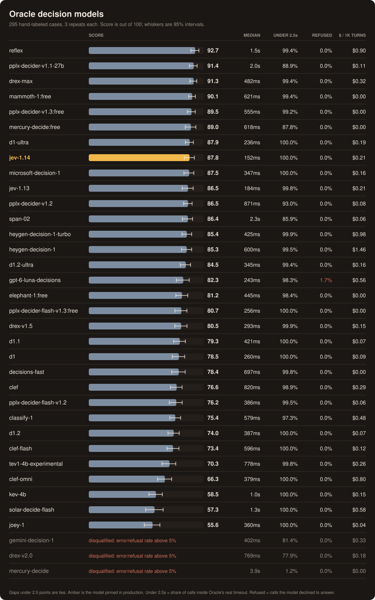
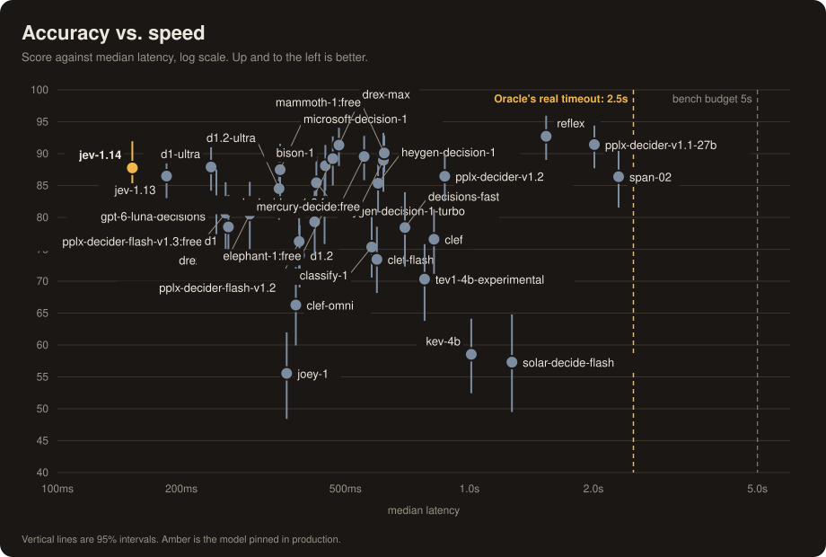
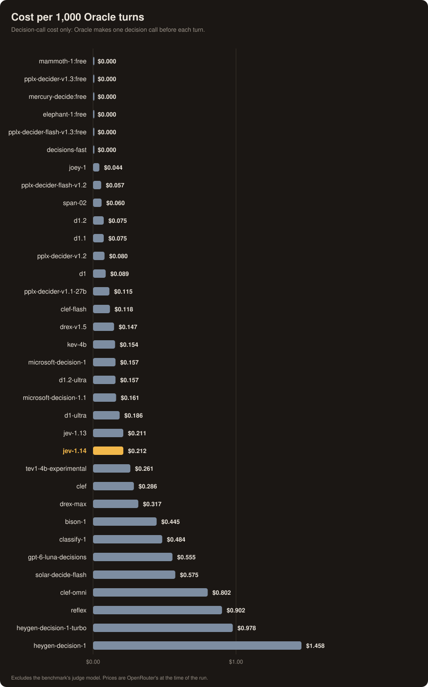
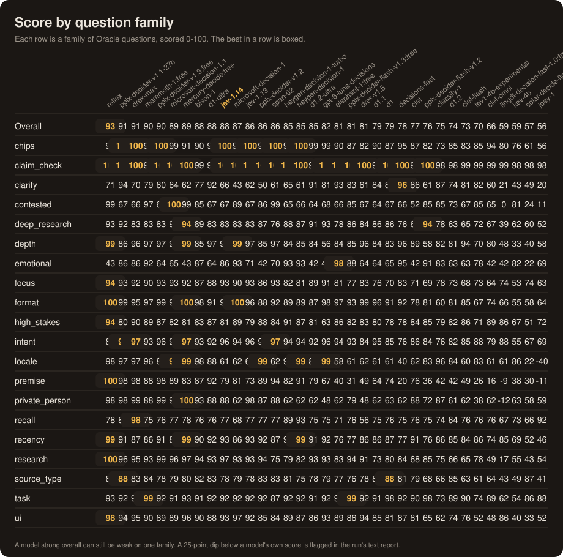

# Oracle decision-model benchmark

Which model should answer Oracle's questions? Oracle mode asks a small, fast **decision model** 23
classification questions before every turn ("does this need fresh data?", "is this about a private
person?", "is the user asking for something deep?") and quietly adjusts how the turn is answered. The
model sits in front of every message, so it has to be **fast, cheap, and right**, in that order.

This page is the result and the recommendation. Per-model detail, the method and the caveats are in
[notes.md](notes.md); the table below is the same one `polaris oracle-bench report` writes to
[results.md](results.md).

<p align="center"></p>

## The answer

**`typesafe/jev-1.14` stays pinned.** It is still the fastest model tested and the best at focus actions,
and the pin is a speed decision rather than an accuracy one: more accurate models exist, at 3x to 10x the
latency in front of the first token.

- **Pinned: `typesafe/jev-1.14`** — 87.8, 152ms median (189ms p95), every call inside Oracle's 2.5s
  timeout, focus actions 98%, $0.212 per 1,000 turns. Weak on one family, `locale` (61).
- **Top score: `morph/reflex`** — 92.7, 4.9 points above Jev and past the noise floor, and it scored that
  twice. The costs are real: 1.5s median, $0.90 per 1,000 turns (a tokenizer problem, not a cache
  problem), focus actions 95%, `emotional` 43, and a tail that crossed the 2.5s cutoff on 5 of 885 calls
  in one of two runs. See [why Reflex costs more](notes.md#why-reflex-costs-more-than-its-list-price).
- **Free-tier fallback: `perplexity/pplx-decider-v1.3:free` (new, 2026-11-13)** — 89.5 (85.8-92.8), a
  statistical tie with the pin and the best free build that still exists, at $0 and 3.9k input tokens a
  call. It is not adopted for the same reason Reflex isn't: 3.6x Jev's median (555ms) with a tail, one
  call at 10.2s and five of 884 over the 2.5s cutoff, on top of weak `clarify` (60) and `emotional` (64).
  The previous best free build, `baseten/mammoth-1` at 90.1, is no longer a free build.
- **Accuracy fallback: `nace-ai/drex-max`** — 91.3, 482ms median, 99.4% inside the timeout, but 1.5x
  Jev's price and a two-request split: it rejects more than 16 questions, so production would need
  `WithMaxQuestions(16)`. See [models with a question cap](notes.md#models-with-a-question-cap).
- **New and not a candidate (2026-11-17): `microsoft/microsoft-decision-1.1`** — 89.2 (85.0-92.7), which is
  1.4 points above the pin and therefore inside the noise: a tie, not a win. What it does fix is the
  predecessor's shape — `clarify` 43 → 64, `locale` 62 → 99 and `private_person` 62 → 91 — at 466ms median
  (347ms for 1.0, 152ms for Jev), $0.161 per 1,000 turns and 99.9% of calls inside the 2.5s cutoff (one at
  2.50s). Not a candidate: three times the pin's latency in front of every turn to tie it. See
  [the 1.1 build](notes.md#microsoft-decision-11).
- **Speed fallback: `liquid/d1-ultra`** — 87.9, a statistical tie with Jev at 236ms, 100% inside the
  timeout, 12% cheaper and far better on `locale`, at 90% focus actions against Jev's 98%.
- **Free-tier fallback on paper only: `baseten/mammoth-1`** — 90.1, no weak family, 621ms, 99.4% inside
  the timeout. It ran as `:free`; Baseten has since replaced that with a paid build.
- **New and not candidates (2026-11-13): the HeyGen pair and Perplexity Flash v1.3** —
  `heygen/heygen-decision-1` (85.3) and `-turbo` (85.4) tie each other and sit 2.4 points behind Jev, with
  worse focus actions (82% and 85% against 98%) and **5 to 7 times the price**: $1.46 and $0.98 per 1,000
  turns, because they bill 10.4k to 10.9k input tokens for the same 23 questions Perplexity answers in
  3.9k. `perplexity/pplx-decider-flash-v1.3:free` (80.7) is the fastest model tested (256ms) and not much
  else: `premise` 31 is the lowest family score on the page. See [the v1.3
  pair](notes.md#perplexity-v13-and-the-heygen-pair).
- **New and not candidates (2026-11-17): Liquid d1.2 and d1.2-ultra** — the newer generation is a step
  backwards. `liquid/d1.2-ultra` scores 84.5 (79.7-88.7), **3.4 points below the D1 Ultra it replaces**
  (87.9), at 345ms median instead of 236ms, with 5 of 885 calls past the 2.5s cutoff and `emotional` 42 as
  its one weak family. `liquid/d1.2` scores 74.0, 5.3 below D1.1 (79.3) and 4.5 below the original D1
  (78.5), with `premise` 42 as its weak family and focus actions at 75%. Both are cheap ($0.157 and $0.075
  per 1,000 turns at 3.7k input tokens a call) and clean (no errors, no refusals), and neither approaches
  the pin. See [the d1.2 pair](notes.md#liquid-d12-and-d12-ultra-a-step-backwards).
- **New and not a candidate (2026-11-20): `baseten/bison-1`** — 88.1 (84.2-91.4), 0.3 points above the pin
  and inside the noise: a tie. Clean (no errors, no refusals in 885 calls) at 447ms median, 520ms p95, 99.9%
  of calls inside the 2.5s cutoff (the one miss took 4.1s), $0.445 per 1,000 turns. It ties Jev on score with three
  times Jev's latency and twice its price, and is weaker at focus actions (90% against Jev's 98%). It is the
  stronger of the two new Baseten builds by a wide margin. See [the Baseten pair](notes.md#baseten-bison-1-and-groundhog-1).
- **New and not a candidate (2026-11-26): `antdigital/lingdt-decision-fast-1.0:free`** — 58.6 (49.9-66.3),
  29 points below the pin and third-weakest of the 35 ranked models. Compatibility is not the problem: 885
  of 885 calls answered, none past the 2.5s cutoff (worst 2.36s), no refusals, $0. It is simply wrong, in both
  directions — it under-fires (`research` on 11 of the 22 messages that need it, `clarify` on 0 of 5, `premise`
  on 2 of 8) and over-fires where it matters most, delivering the private-person nudge on questions about
  public figures and non-people ("who painted the Mona Lisa", "who wrote Pride and Prejudice"). That puts it
  at **2.6% dangerous false nudges (10 of 391)** against the pin's 0.5%, the loosest of the free builds
  measured, with the second-least calibrated probabilities on the page (Brier 0.32 against the pin's 0.16). At
  1.3s median it is also 8.6x the pin's latency. See [the LingDT
  section](notes.md#ant-digitals-lingdt-decision-fast-10).
- **Gone since the run:** `perplexity/pplx-decider-v1.1-27b` (second place, `HTTP 404` since 2026-10-26)
  and both Mercury entries (404 as of 2026-11-10). Those rows are records, not options.
- **New and disqualified (2026-11-11): `google/gemini-decision-1`** — the calls that answered were fast
  (402ms median, every one inside the 2.5s timeout) and scored 80.3, but 19% of them never answered at
  all: OpenRouter's shared Google quota returns `429 Rate limit exceeded` in bursts, and four attempts
  across two concurrencies landed between 19% and 39% errors. See [the shared Google
  quota](notes.md#gemini-decision-1-and-the-shared-google-quota).
- **New and disqualified (2026-11-20): `baseten/groundhog-1`** — the calls that answered were the fastest
  of the two new Baseten builds (343ms median, 417ms p95) and scored 81.5, but 23% of the run never
  answered: every failure is `429 Rate limit exceeded`, none is a refusal or a question cap, and all of
  them land in the back half of a run. Two attempts, 16% errors at concurrency 2 and 23% at concurrency 1,
  so lowering the load did not help. Its two "weak families" (`source_type` 56, `ui` 57) are where the 429s landed, not a finding about the model. Not ranked. See [the Baseten pair](notes.md#baseten-bison-1-and-groundhog-1).

## Results

Runs of 2026-10-16 to 2026-11-26: 295 hand-labeled cases (274 scored; 21 have disputed labels and are
reported separately), 3 repeats each, 2 calls in flight (the Drex models, Gemini and Groundhog ran at 1), weights
`a6cbc140bd53`. The whole thing cost **$11.34**, about $0.86 of it the judge, $1.07 of it the four
Gemini attempts (the 429s themselves are free, but not the calls that then re-sent them), $2.16 of it
the HeyGen pair, $0.28 of it the d1.2 pair, $0.18 of it Microsoft Decision 1.1, $0.77 of it the Baseten
pair's two attempts (judge included) and $0.03 of it the LingDT run, all of that the judge — its decision
calls were free. Raw leaderboards for every invocation are in [`runs/`](runs/), and
[notes.md#runs](notes.md#runs) lists which models ran when.

| # | Model | Score (95% CI) | Verdict | Trigger | Focus | Danger FP | Errors | p50 | p95 | Under 2.5s | $/1k turns |
|--:|---|---|--:|--:|--:|--:|--:|--:|--:|--:|--:|--:| 
| 1 | `morph/reflex` | **92.7** (89.0-95.9) | 98% | 98% | 95% | 1% | 0% | 1.5s | 1.8s | 99.4% | $0.902 |
| 2 | `perplexity/pplx-decider-v1.1-27b` (retired) § | **91.4** (87.7-94.4) | 97% | 98% | 95% | 0% | 1% | 2.0s | 3.7s | 88.9% | $0.115 |
| 3 | `nace-ai/drex-max` † (split) | **91.3** (88.1-94.1) | 97% | 97% | 95% | 0% | 0% | 482ms | 1.2s | 99.4% | $0.317 |
| 4 | `baseten/mammoth-1:free` | **90.1** (87.1-92.9) | 97% | 97% | 92% | 0% | 0% | 621ms | 1.1s | 99.4% | $0.000 |
| 5 | `perplexity/pplx-decider-v1.3:free` | **89.5** (85.8-92.8) | 97% | 97% | 95% | 0% | 0% | 555ms | 1.3s | 99.2% | $0.000 |
| 6 | `microsoft/microsoft-decision-1.1` | **89.2** (85.0-92.7) | 96% | 96% | 95% | 1% | 0% | 466ms | 613ms | 99.9% | $0.161 |
| 7 | `inception/mercury-decide:free` (retired) § | **89.0** (84.0-93.3) | 97% | 97% | 95% | 1% | 0% | 618ms | 4.3s | 87.8% | $0.000 |
| 8 | `baseten/bison-1` | **88.1** (84.2-91.4) | 97% | 96% | 90% | 0% | 0% | 447ms | 520ms | 99.9% | $0.445 |
| 9 | `liquid/d1-ultra` § | **87.9** (84.2-91.1) | 96% | 96% | 90% | 0% | 0% | 236ms | 340ms | 100.0% | $0.186 |
| 10 | `typesafe/jev-1.14` § | **87.8** (83.2-92.0) | 96% | 96% | 98% | 1% | 0% | 152ms | 189ms | 100.0% | $0.212 |
| 11 | `microsoft/microsoft-decision-1` § | **87.5** (82.9-91.5) | 95% | 96% | 95% | 1% | 0% | 347ms | 424ms | 100.0% | $0.157 |
| 12 | `typesafe/jev-1.13` § | **86.5** (81.4-90.9) | 96% | 96% | 95% | 1% | 0% | 184ms | 272ms | 99.8% | $0.211 |
| 13 | `perplexity/pplx-decider-v1.2` | **86.5** (82.6-90.0) | 96% | 95% | 90% | 1% | 0% | 871ms | 3.7s | 93.0% | $0.080 |
| 14 | `respan/span-02` | **86.4** (81.5-90.4) | 95% | 96% | 98% | 1% | 0% | 2.3s | 2.6s | 85.9% | $0.060 |
| 15 | `heygen/heygen-decision-1-turbo` | **85.4** (81.2-89.6) | 96% | 96% | 85% | 0% | 0% | 425ms | 1.2s | 99.9% | $0.978 |
| 16 | `heygen/heygen-decision-1` | **85.3** (80.8-89.6) | 96% | 96% | 82% | 1% | 0% | 600ms | 1.4s | 99.5% | $1.458 |
| 17 | `liquid/d1.2-ultra` | **84.5** (79.7-88.7) | 96% | 96% | 92% | 1% | 0% | 345ms | 890ms | 99.4% | $0.157 |
| 18 | `openai/gpt-6-luna-decisions` § | **82.3** (76.3-87.5) | 94% | 96% | 95% | 1% | 2% | 243ms | 409ms | 98.3% | $0.555 |
| 19 | `baseten/elephant-1:free` | **81.2** (75.8-86.2) | 95% | 96% | 80% | 0% | 0% | 445ms | 765ms | 98.4% | $0.000 |
| 20 | `perplexity/pplx-decider-flash-v1.3:free` | **80.7** (75.1-85.5) | 95% | 96% | 75% | 0% | 0% | 256ms | 444ms | 100.0% | $0.000 |
| 21 | `nace-ai/drex-v1.5` † | **80.5** (75.0-85.6) | 94% | 96% | 82% | 1% | 0% | 293ms | 851ms | 99.9% | $0.147 |
| 22 | `liquid/d1.1` | **79.3** (74.0-84.2) | 95% | 95% | 80% | 1% | 0% | 421ms | 654ms | 100.0% | $0.075 |
| 23 | `liquid/d1` § | **78.5** (72.7-83.5) | 95% | 95% | 68% | 1% | 0% | 260ms | 411ms | 100.0% | $0.089 |
| 24 | `parallel/decisions-fast` ‡ | **78.4** (72.3-84.0) | 94% | 95% | 85% | 1% | 0% | 697ms | 1.0s | 99.8% | $0.000 |
| 25 | `cloudflare/clef` § | **76.6** (71.2-81.3) | 95% | 94% | 75% | 1% | 0% | 820ms | 1.9s | 98.9% | $0.286 |
| 26 | `perplexity/pplx-decider-flash-v1.2` | **76.2** (70.2-81.4) | 95% | 93% | 70% | 1% | 0% | 386ms | 507ms | 99.5% | $0.057 |
| 27 | `scaledown/classify-1` § | **75.4** (70.6-80.0) | 93% | 92% | 82% | 0% | 0% | 579ms | 1.4s | 97.3% | $0.484 |
| 28 | `liquid/d1.2` | **74.0** (69.0-78.8) | 95% | 93% | 75% | 1% | 0% | 387ms | 809ms | 100.0% | $0.075 |
| 29 | `cloudflare/clef-flash` § | **73.4** (68.2-78.5) | 94% | 94% | 72% | 1% | 0% | 596ms | 1.3s | 100.0% | $0.118 |
| 30 | `togethercomputer/tev1-4b-experimental` | **70.3** (63.8-75.8) | 93% | 91% | 75% | 1% | 0% | 778ms | 1.0s | 99.8% | $0.261 |
| 31 | `cloudflare/clef-omni` | **66.3** (59.9-72.2) | 93% | 92% | 68% | 1% | 0% | 379ms | 562ms | 100.0% | $0.802 |
| 32 | `antdigital/lingdt-decision-fast-1.0:free` | **58.6** (49.9-66.3) | 86% | 90% | 88% | 3% | 0% | 1.3s | 1.4s | 100.0% | $0.000 |
| 33 | `jaredpalmer/kev-4b` | **58.5** (52.4-64.1) | 94% | 87% | 55% | 0% | 0% | 1.0s | 1.6s | 100.0% | $0.154 |
| 34 | `upstage/solar-decide-flash` § | **57.3** (49.5-64.8) | 84% | 89% | 85% | 4% | 0% | 1.3s | 1.6s | 100.0% | $0.575 |
| 35 | `baseten/joey-1` | **55.6** (48.4-62.0) | 85% | 89% | 68% | 0% | 0% | 360ms | 572ms | 100.0% | $0.044 |
| x | `baseten/groundhog-1` † | **81.5** (77.0-85.5) | 90% | 96% | 90% | 0% | 23% | 343ms | 417ms | 77.1% | $0.119 |
| x | `google/gemini-decision-1` † | **80.3** (74.8-85.6) | 92% | 96% | 84% | 0% | 19% | 402ms | 643ms | 81.4% | $0.334 |
| x | `nace-ai/drex-v2.0` † (split) | **64.7** (58.1-70.6) | 80% | 92% | 70% | 1% | 22% | 769ms | 1.6s | 77.9% | $0.175 |
| x | `inception/mercury-decide` (retired) § | **4.6** (2.4-7.5) | 4% | 97% | 100% | 0% | 96% | 3.9s | 13.3s | 1.2% | $0.004 |

**x** is disqualified: over 5% errors or refusals, which in every case traces to the provider (`429`
quota, `429 Model busy`, `429 rate_limit_exceeded`) rather than the question set. Gemini's row is the best
of four attempts and Groundhog's the better of two; every answered call in all four was inside the 2.5s timeout, so its latency columns are
sound, and its score is what it managed on the calls the provider let through. **†** ran at concurrency 1
rather than 2, so its latency and under-2.5s share are a best case; accuracy is unaffected. **§** predates per-call cost capture, so its
cost is the average over identical repeats and may run a few percent low for a cache-capable model.
**‡** is "not billed", not free: every call came back with `usage.cost: 0`, while the catalog price would
put it near $0.93 per 1,000 turns.

*Under 2.5s* is the share of calls that answered inside Oracle's real timeout (`oracleTimeout` in
`gateway/oracle.go`); a call over it is dropped and that turn runs with Oracle off. *$/1k turns* is one
decision call per turn, measured on the first send of each state, which is what a production turn is.
*Verdict*, *trigger* and *focus* describe what production's own rules did with each answer, not just
whether the raw answer was right.

## Reading the ranking

With 274 scored cases the intervals are about ±4 points, so a gap under 2.5 points is noise and rank
within a tier means nothing. Four tiers:

- **Reflex, Perplexity v1.1 (retired), Drex Max, Mammoth** — 90 and up.
- **Perplexity v1.3 free, Mercury free (retired), Bison 1, D1 Ultra, Jev 1.14, Microsoft, Jev 1.13,
  Perplexity v1.2, Span-02** — 86 to 90, a statistical tie.
- **The HeyGen pair, Luna, Elephant, Perplexity Flash v1.3 free, Drex 1.5, D1.1, D1, Clef, Flash v1.2,
  Classify 1** — 75 to 85.
- **Clef Flash, Tev1, Clef Omni, LingDT Fast, Kev, Solar Flash, Joey 1** — 55 to 74.

Drex 2.0, Gemini 1 and Groundhog 1 are in no tier: 22%, 19% and 23% of their calls respectively failed
upstream (`429 Model busy`, `429 Rate limit exceeded`), so all three are disqualified rather than ranked.

Only two things separate the leaders, and neither is in the score: **speed** (Jev is 10x faster at the
median than Reflex) and **focus actions**, the one check that changes what Oracle actually does rather
than what it says (Jev 98%, Drex Max and Mammoth 92 to 95%).

<p align="center"></p>

Cost is a rounding error at this scale — the priciest model tested is $1.46 per 1,000 turns — so it
decides nothing here. It is reported because a model whose catalog price and measured bill disagree
(Reflex by 4.5x) is a trap worth seeing, and because the HeyGen pair's bill comes from a tokenizer that
burns 10k tokens on a 4k-token prompt, which no catalog price shows.

<p align="center"></p>

<p align="center"></p>

## Roster status (checked 2026-11-26)

`GET /api/v1/models?output_modalities=decisions` returned **45 entries**: 34 ids that are rows in the
table (31 scored, plus Drex 2.0, Gemini 1 and Groundhog 1 disqualified), 5 `~` aliases, and 6 ids with no
row. The filter is on output modality, not on "can answer Choice questions", so each of the 6 is a
judgment rather than an omission:

| Model | Why it has no row |
|---|---|
| `nace-ai/drex-max-finance` | Probed 2026-11-10: it drops Max's 16-question cap, but scored 84.0 against Max's 86.9 on 60 cases with 93.3% per-check agreement — the same model with a finance tilt, `emotional` -32, and 1% dangerous false nudges against Max's 0%. Recorded in the [plan doc](../../plans/oracle-benchmark.md). |
| `respan/span-01`, `-lite`, `-lite:free` | `noul`-only: they reject every Choice question, so they are N/A rather than scored zero. |
| `upstage/solar-decide` | Answers correctly but takes 10 to 21s per call, 4x Oracle's timeout. |
| `cloudflare/clairic` | Not a decision model: `/api/alpha/extractions` only, a different response shape. |
| `baseten/mammoth-1`, `baseten/elephant-1` | The same builds the table ran as `:free`, now paid ($0.10/M and $0.035/M). Not re-run, since the weights did not change. |
| the 5 `~…-latest` aliases | A moving alias makes a result uninterpretable, so the versioned id is what runs. |

Free and paid have swapped in both directions since the runs, which is why the table names the build it
measured: Mammoth and Elephant moved `:free` → paid, and Parallel went the other way — its `:free` id now
has no endpoints while the paid id serves a $0 one, so the 78.4 row is unchanged and still free. Both
Mercury entries, Perplexity v1.1, `liquid/d1` and `liquid/d1.1` now resolve to no endpoints at all, so their
rows are records. Google's entry appeared on 2026-11-11 and has a row, so it does not appear in that table —
but it is worth re-checking once the launch-week quota pressure in
[notes](notes.md#gemini-decision-1-and-the-shared-google-quota) subsides. Perplexity v1.3 and the two
HeyGen builds arrived on 2026-11-12 and were run on 2026-11-13; Ant Digital's LingDT arrived on 2026-11-26,
and only its `:free` id has endpoints, so it carries the free-tier caveats — it can be rate-limited or
withdrawn without notice, as Mammoth's was.

## Where things are

- [notes.md](notes.md) — per-model notes, question caps, refusals, why Reflex costs more, method,
  caveats, and the full reproduce steps.
- [results.md](results.md) — the same table, generated.
- [`runs/`](runs/) — the saved leaderboards this page is built from; commit a new one with every run.
- [`call-stats.json`](call-stats.json) — per-model call tallies (timeout share, refusals by family) so the
  charts rebuild without the raw logs.
- [`oraclebench/weights.yaml`](../../../oraclebench/weights.yaml) — scoring weights and the 5s bench
  budget (deliberately looser than production's 2.5s).
- [Design and decisions](../../plans/oracle-benchmark.md), [how to write cases](../../../oraclebench/AUTHORING.md).

## Reproduce it

```bash
# a new model runs in its own invocation, same flags as every other one
polaris oracle-bench --models morph/reflex --repeats 3 --seed 1 --concurrency 2 --timeout 15s \
  --label "morph reflex"

# then merge every saved leaderboard back into the table and charts
polaris oracle-bench report \
  --run docs/benchmarks/oracle-decision-models/runs/<a>.json,docs/benchmarks/oracle-decision-models/runs/<b>.json,... \
  --calls 'oraclebench/results/*-calls.jsonl'
```

Pacing for `:free` models, the `--calls` footgun, and what makes two runs mergeable are in
[notes.md#reproduce-it](notes.md#reproduce-it).
