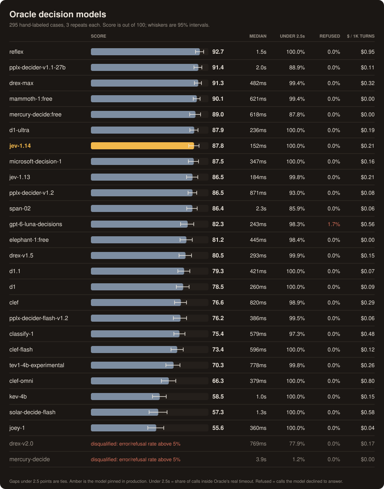
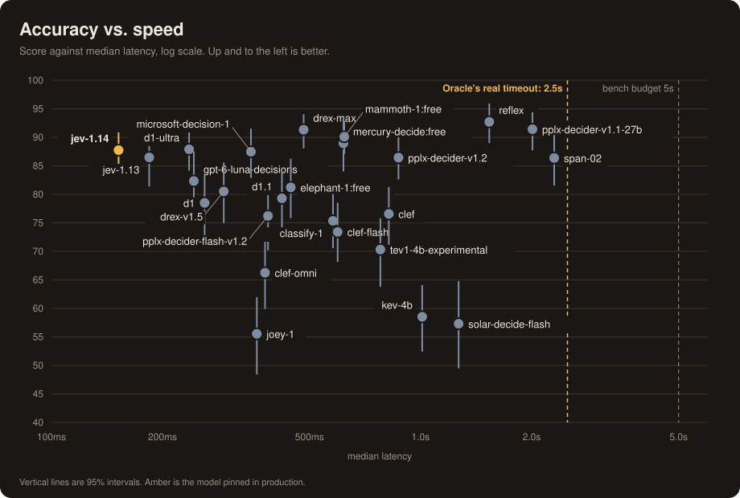
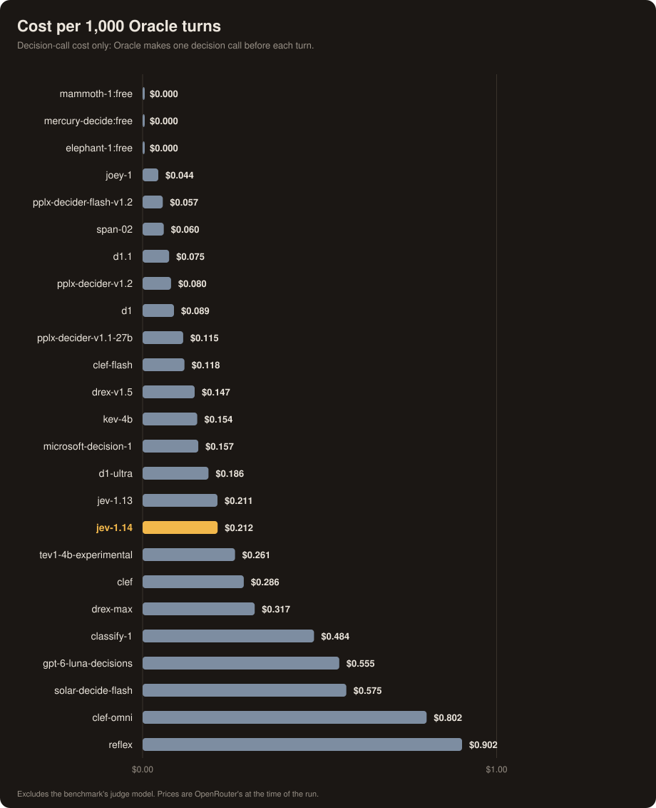
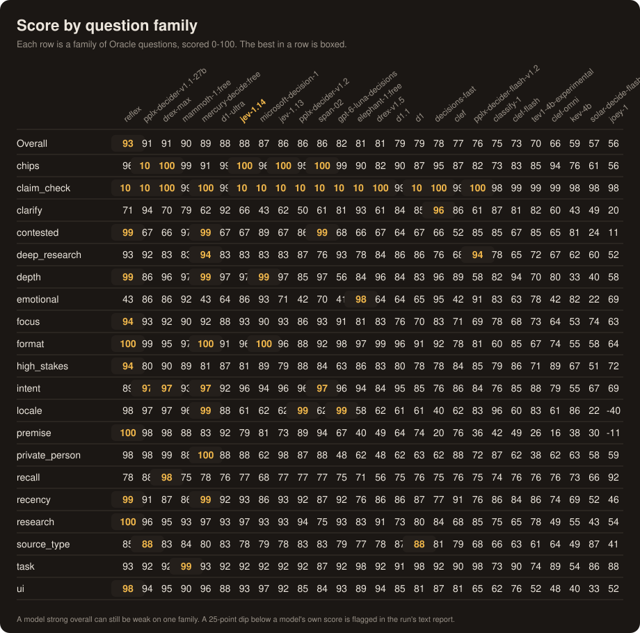

# Oracle decision-model benchmark

Which model should answer Oracle's questions? Oracle mode asks a small, fast **decision model** 23
classification questions before every turn ("does this need fresh data?", "is this about a private
person?", "is the user asking for something deep?") and quietly adjusts how the turn is answered. The
model sits in front of every message, so it has to be **fast, cheap, and right**, in that order.

This page is the result and the recommendation. Per-model detail, the method and the caveats are in
[notes.md](notes.md); the table below is the same one `polaris oracle-bench report` writes to
[results.md](results.md).

<p align="center"></p>

## The answer

**`typesafe/jev-1.14` stays pinned.** It is still the fastest model tested and the best at focus actions,
and the pin is a speed decision rather than an accuracy one: more accurate models exist, at 3x to 10x the
latency in front of the first token.

- **Pinned: `typesafe/jev-1.14`** — 87.8, 152ms median (189ms p95), every call inside Oracle's 2.5s
  timeout, focus actions 98%, $0.212 per 1,000 turns. Weak on one family, `locale` (61).
- **Top score: `morph/reflex`** — 92.7, 4.9 points above Jev and past the noise floor, and it scored that
  twice. The costs are real: 1.5s median, $0.90 per 1,000 turns (a tokenizer problem, not a cache
  problem), focus actions 95%, `emotional` 43, and a tail that crossed the 2.5s cutoff on 5 of 885 calls
  in one of two runs. See [why Reflex costs more](notes.md#why-reflex-costs-more-than-its-list-price).
- **Accuracy fallback: `nace-ai/drex-max`** — 91.3, 482ms median, 99.4% inside the timeout, but 1.5x
  Jev's price and a two-request split: it rejects more than 16 questions, so production would need
  `WithMaxQuestions(16)`. See [models with a question cap](notes.md#models-with-a-question-cap).
- **Speed fallback: `liquid/d1-ultra`** — 87.9, a statistical tie with Jev at 236ms, 100% inside the
  timeout, 12% cheaper and far better on `locale`, at 90% focus actions against Jev's 98%.
- **Free-tier fallback: `baseten/mammoth-1`** — 90.1, no weak family, 621ms, 99.4% inside the timeout. It
  ran as `:free`; Baseten has since replaced that with a paid build.
- **Gone since the run:** `perplexity/pplx-decider-v1.1-27b` (second place, `HTTP 404` since 2026-10-26)
  and both Mercury entries (404 as of 2026-11-10). Those rows are records, not options.
- **New and disqualified (2026-11-11): `google/gemini-decision-1`** — the calls that answered were fast
  (402ms median, every one inside the 2.5s timeout) and scored 80.3, but 19% of them never answered at
  all: OpenRouter's shared Google quota returns `429 Rate limit exceeded` in bursts, and four attempts
  across two concurrencies landed between 19% and 39% errors. See [the shared Google
  quota](notes.md#gemini-decision-1-and-the-shared-google-quota).

## Results

Runs of 2026-10-16 to 2026-11-11: 295 hand-labeled cases (274 scored; 21 have disputed labels and are
reported separately), 3 repeats each, 2 calls in flight (the Drex models and Gemini ran at 1), weights
`a6cbc140bd53`. The whole thing cost **$7.80**, about $0.54 of it the judge and $1.07 of it the four
Gemini attempts — of which the 429s themselves are free, but not the calls that then re-sent them. Raw
leaderboards for every invocation are in [`runs/`](runs/), and [notes.md#runs](notes.md#runs) lists which
models ran when.

| # | Model | Score (95% CI) | Verdict | Trigger | Focus | Danger FP | Errors | p50 | p95 | Under 2.5s | $/1k turns |
|--:|---|---|--:|--:|--:|--:|--:|--:|--:|--:|--:|
| 1 | `morph/reflex` | **92.7** (89.0-95.9) | 98% | 98% | 95% | 1% | 0% | 1.5s | 1.8s | 99.4% | $0.902 |
| 2 | `perplexity/pplx-decider-v1.1-27b` (retired) § | **91.4** (87.7-94.4) | 97% | 98% | 95% | 0% | 1% | 2.0s | 3.7s | 88.9% | $0.115 |
| 3 | `nace-ai/drex-max` † (split) | **91.3** (88.1-94.1) | 97% | 97% | 95% | 0% | 0% | 482ms | 1.2s | 99.4% | $0.317 |
| 4 | `baseten/mammoth-1:free` | **90.1** (87.1-92.9) | 97% | 97% | 92% | 0% | 0% | 621ms | 1.1s | 99.4% | $0.000 |
| 5 | `inception/mercury-decide:free` (retired) § | **89.0** (84.0-93.3) | 97% | 97% | 95% | 1% | 0% | 618ms | 4.3s | 87.8% | $0.000 |
| 6 | `liquid/d1-ultra` § | **87.9** (84.2-91.1) | 96% | 96% | 90% | 0% | 0% | 236ms | 340ms | 100.0% | $0.186 |
| 7 | `typesafe/jev-1.14` § | **87.8** (83.2-92.0) | 96% | 96% | 98% | 1% | 0% | 152ms | 189ms | 100.0% | $0.212 |
| 8 | `microsoft/microsoft-decision-1` § | **87.5** (82.9-91.5) | 95% | 96% | 95% | 1% | 0% | 347ms | 424ms | 100.0% | $0.157 |
| 9 | `typesafe/jev-1.13` § | **86.5** (81.4-90.9) | 96% | 96% | 95% | 1% | 0% | 184ms | 272ms | 99.8% | $0.211 |
| 10 | `perplexity/pplx-decider-v1.2` | **86.5** (82.6-90.0) | 96% | 95% | 90% | 1% | 0% | 871ms | 3.7s | 93.0% | $0.080 |
| 11 | `respan/span-02` | **86.4** (81.5-90.4) | 95% | 96% | 98% | 1% | 0% | 2.3s | 2.6s | 85.9% | $0.060 |
| 12 | `openai/gpt-6-luna-decisions` § | **82.3** (76.3-87.5) | 94% | 96% | 95% | 1% | 2% | 243ms | 409ms | 98.3% | $0.555 |
| 13 | `baseten/elephant-1:free` | **81.2** (75.8-86.2) | 95% | 96% | 80% | 0% | 0% | 445ms | 765ms | 98.4% | $0.000 |
| 14 | `nace-ai/drex-v1.5` † | **80.5** (75.0-85.6) | 94% | 96% | 82% | 1% | 0% | 293ms | 851ms | 99.9% | $0.147 |
| 15 | `liquid/d1.1` | **79.3** (74.0-84.2) | 95% | 95% | 80% | 1% | 0% | 421ms | 654ms | 100.0% | $0.075 |
| 16 | `liquid/d1` § | **78.5** (72.7-83.5) | 95% | 95% | 68% | 1% | 0% | 260ms | 411ms | 100.0% | $0.089 |
| 17 | `parallel/decisions-fast` ‡ | **78.4** (72.3-84.0) | 94% | 95% | 85% | 1% | 0% | 697ms | 1.0s | 99.8% | $0.000 |
| 18 | `cloudflare/clef` § | **76.6** (71.2-81.3) | 95% | 94% | 75% | 1% | 0% | 820ms | 1.9s | 98.9% | $0.286 |
| 19 | `perplexity/pplx-decider-flash-v1.2` | **76.2** (70.2-81.4) | 95% | 93% | 70% | 1% | 0% | 386ms | 507ms | 99.5% | $0.057 |
| 20 | `scaledown/classify-1` § | **75.4** (70.6-80.0) | 93% | 92% | 82% | 0% | 0% | 579ms | 1.4s | 97.3% | $0.484 |
| 21 | `cloudflare/clef-flash` § | **73.4** (68.2-78.5) | 94% | 94% | 72% | 1% | 0% | 596ms | 1.3s | 100.0% | $0.118 |
| 22 | `togethercomputer/tev1-4b-experimental` | **70.3** (63.8-75.8) | 93% | 91% | 75% | 1% | 0% | 778ms | 1.0s | 99.8% | $0.261 |
| 23 | `cloudflare/clef-omni` | **66.3** (59.9-72.2) | 93% | 92% | 68% | 1% | 0% | 379ms | 562ms | 100.0% | $0.802 |
| 24 | `jaredpalmer/kev-4b` | **58.5** (52.4-64.1) | 94% | 87% | 55% | 0% | 0% | 1.0s | 1.6s | 100.0% | $0.154 |
| 25 | `upstage/solar-decide-flash` § | **57.3** (49.5-64.8) | 84% | 89% | 85% | 4% | 0% | 1.3s | 1.6s | 100.0% | $0.575 |
| 26 | `baseten/joey-1` | **55.6** (48.4-62.0) | 85% | 89% | 68% | 0% | 0% | 360ms | 572ms | 100.0% | $0.044 |
| x | `google/gemini-decision-1` † | **80.3** (74.8-85.6) | 92% | 96% | 84% | 0% | 19% | 402ms | 643ms | 81.4% | $0.334 |
| x | `nace-ai/drex-v2.0` † (split) | **64.7** (58.1-70.6) | 80% | 92% | 70% | 1% | 22% | 769ms | 1.6s | 77.9% | $0.175 |
| x | `inception/mercury-decide` (retired) § | **4.6** (2.4-7.5) | 4% | 97% | 100% | 0% | 96% | 3.9s | 13.3s | 1.2% | $0.004 |

**x** is disqualified: over 5% errors or refusals, which in every case traces to the provider (`429`
quota, `429 Model busy`, `429 rate_limit_exceeded`) rather than the question set. Gemini's row is the best
of four attempts; every answered call in all four was inside the 2.5s timeout, so its latency columns are
sound, and its score is what it managed on the calls the provider let through. **†** ran at concurrency 1
rather than 2, so its latency and under-2.5s share are a best case; accuracy is unaffected. **§** predates per-call cost capture, so its
cost is the average over identical repeats and may run a few percent low for a cache-capable model.
**‡** is "not billed", not free: every call came back with `usage.cost: 0`, while the catalog price would
put it near $0.93 per 1,000 turns.

*Under 2.5s* is the share of calls that answered inside Oracle's real timeout (`oracleTimeout` in
`gateway/oracle.go`); a call over it is dropped and that turn runs with Oracle off. *$/1k turns* is one
decision call per turn, measured on the first send of each state, which is what a production turn is.
*Verdict*, *trigger* and *focus* describe what production's own rules did with each answer, not just
whether the raw answer was right.

## Reading the ranking

With 274 scored cases the intervals are about ±4 points, so a gap under 2.5 points is noise and rank
within a tier means nothing. Four tiers:

- **Reflex, Perplexity v1.1 (retired), Drex Max, Mammoth** — 90 and up.
- **D1 Ultra, Jev 1.14, Microsoft, Jev 1.13, Perplexity v1.2, Span-02, Mercury free (retired)** — 86 to
  89, a statistical tie.
- **Luna, Elephant, Drex 1.5, D1.1, D1, Clef, Flash v1.2, Classify 1** — 75 to 82.
- **Clef Flash, Tev1, Clef Omni, Kev, Solar Flash, Joey 1** — 55 to 74.

Drex 2.0 and Gemini 1 are in no tier: 22% and 19% of their calls respectively failed upstream (`429 Model
busy`, `429 Rate limit exceeded`), so both are disqualified rather than ranked.

Only two things separate the leaders, and neither is in the score: **speed** (Jev is 10x faster at the
median than Reflex) and **focus actions**, the one check that changes what Oracle actually does rather
than what it says (Jev 98%, Drex Max and Mammoth 92 to 95%).

<p align="center"></p>

Cost is a rounding error at this scale — the priciest model tested is $0.90 per 1,000 turns — so it
decides nothing here. It is reported because a model whose catalog price and measured bill disagree
(Reflex by 4.5x) is a trap worth seeing.

<p align="center"></p>

<p align="center"></p>

## Roster status (checked 2026-11-11)

`GET /api/v1/models?output_modalities=decisions` returned **37 entries**: 23 ids that are rows in the
table (22 scored, plus Gemini 1's disqualified one), 5 `~` aliases, and 9 ids with no row. The filter is
on output modality, not on "can answer Choice questions", so each of the 9 is a judgment rather than an
omission:

| Model | Why it has no row |
|---|---|
| `nace-ai/drex-max-finance` | Probed 2026-11-10: it drops Max's 16-question cap, but scored 84.0 against Max's 86.9 on 60 cases with 93.3% per-check agreement — the same model with a finance tilt, `emotional` -32, and 1% dangerous false nudges against Max's 0%. Recorded in the [plan doc](../../plans/oracle-benchmark.md). |
| `respan/span-01`, `-lite`, `-lite:free` | `noul`-only: they reject every Choice question, so they are N/A rather than scored zero. |
| `upstage/solar-decide` | Answers correctly but takes 10 to 21s per call, 4x Oracle's timeout. |
| `cloudflare/clairic` | Not a decision model: `/api/alpha/extractions` only, a different response shape. |
| `baseten/mammoth-1`, `baseten/elephant-1` | The same builds the table ran as `:free`, now paid ($0.10/M and $0.035/M). Not re-run, since the weights did not change. |
| `parallel/decisions-fast:free` | A free build of a model already ruled out at 78.4 (see [notes](notes.md#parallel-decisions-fast-web-grounded)). |
| the 5 `~…-latest` aliases | A moving alias makes a result uninterpretable, so the versioned id is what runs. |

Free and paid have swapped in both directions since the runs, which is why the table names the build it
measured: Mammoth and Elephant moved `:free` → paid, Parallel moved paid → `:free`. Both Mercury entries and
Perplexity v1.1 now return `HTTP 404 No endpoints found`, so their rows are records. `liquid/d1` is still
listed beside `d1.1`. Google's entry is new on 2026-11-11 and has a row, so it does not appear in that
table — but it is worth re-checking once the launch-week quota pressure in
[notes](notes.md#gemini-decision-1-and-the-shared-google-quota) subsides.

## Where things are

- [notes.md](notes.md) — per-model notes, question caps, refusals, why Reflex costs more, method,
  caveats, and the full reproduce steps.
- [results.md](results.md) — the same table, generated.
- [`runs/`](runs/) — the saved leaderboards this page is built from; commit a new one with every run.
- [`call-stats.json`](call-stats.json) — per-model call tallies (timeout share, refusals by family) so the
  charts rebuild without the raw logs.
- [`oraclebench/weights.yaml`](../../../oraclebench/weights.yaml) — scoring weights and the 5s bench
  budget (deliberately looser than production's 2.5s).
- [Design and decisions](../../plans/oracle-benchmark.md), [how to write cases](../../../oraclebench/AUTHORING.md).

## Reproduce it

```bash
# a new model runs in its own invocation, same flags as every other one
polaris oracle-bench --models morph/reflex --repeats 3 --seed 1 --concurrency 2 --timeout 15s \
  --label "morph reflex"

# then merge every saved leaderboard back into the table and charts
polaris oracle-bench report \
  --run docs/benchmarks/oracle-decision-models/runs/<a>.json,docs/benchmarks/oracle-decision-models/runs/<b>.json,... \
  --calls 'oraclebench/results/*-calls.jsonl'
```

Pacing for `:free` models, the `--calls` footgun, and what makes two runs mergeable are in
[notes.md#reproduce-it](notes.md#reproduce-it).
