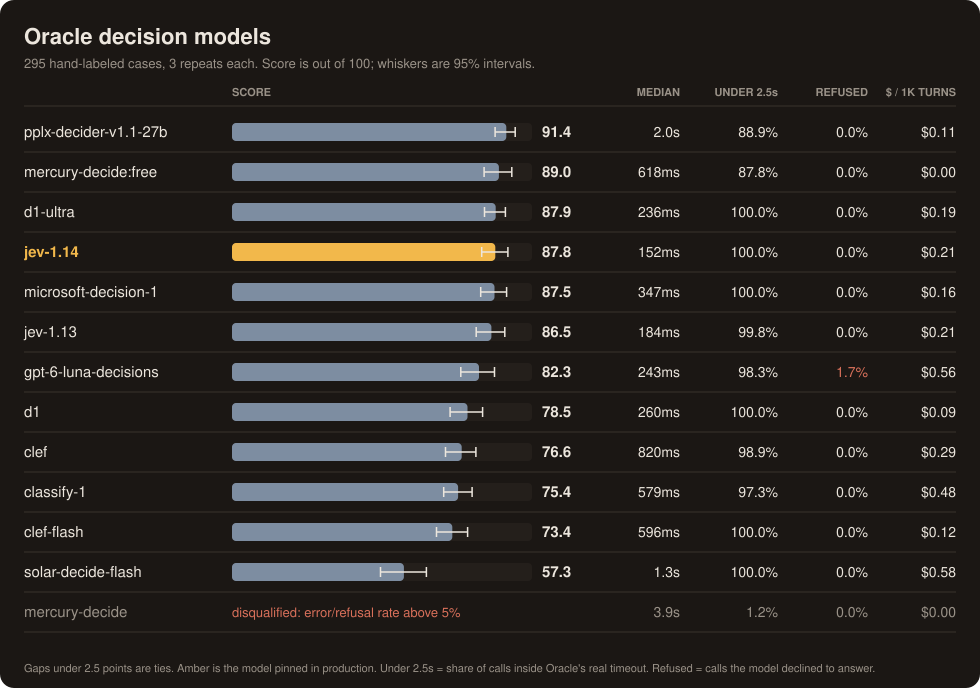
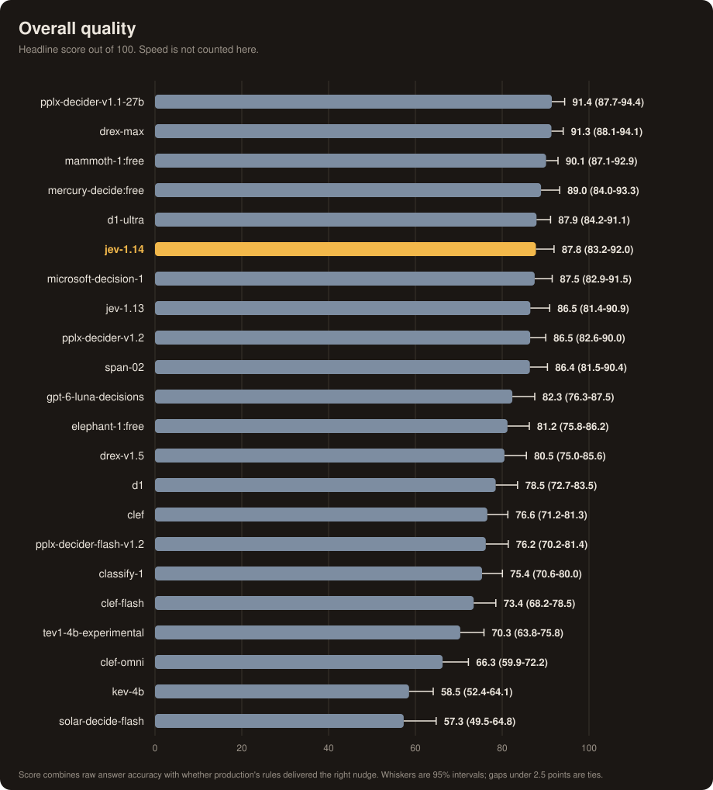
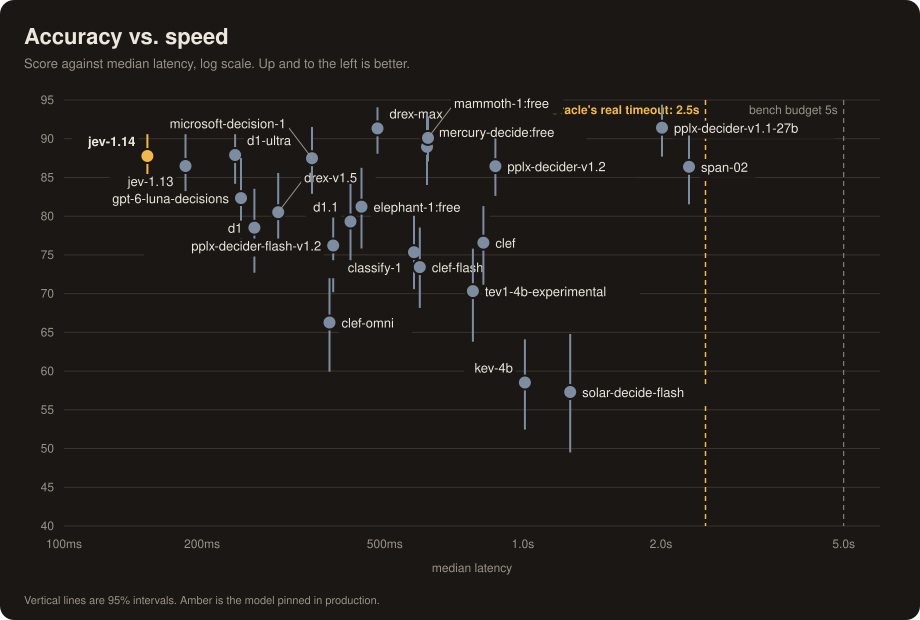
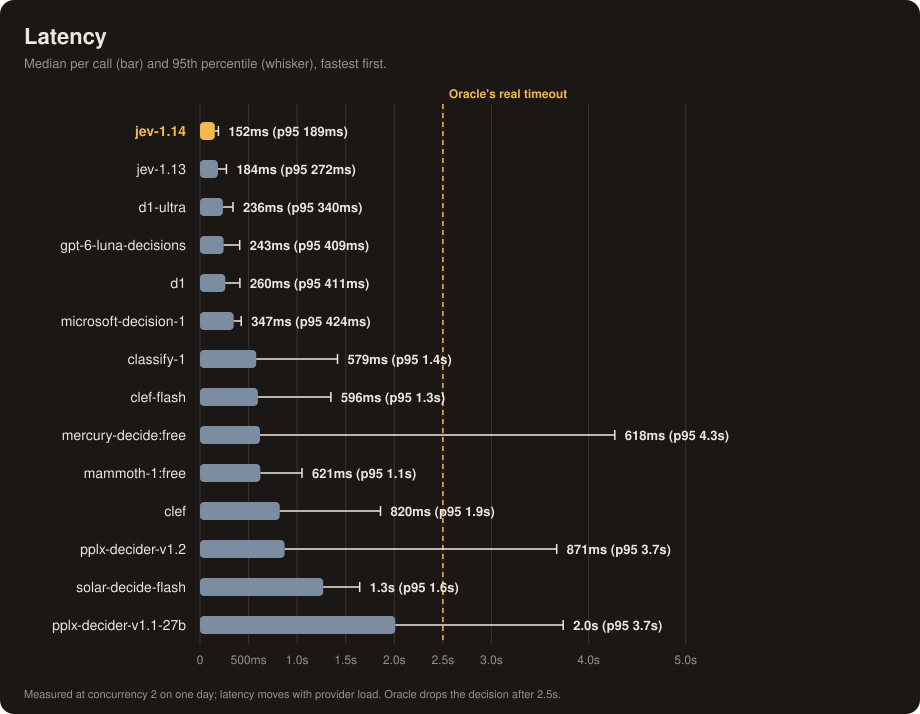
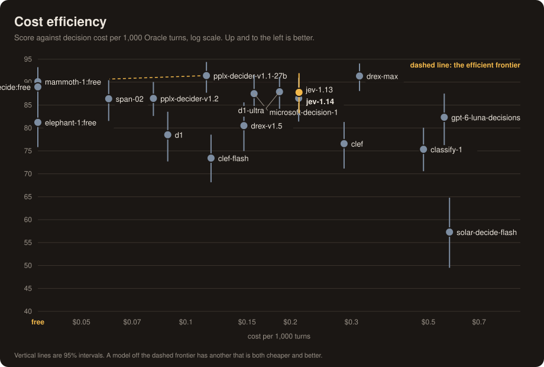
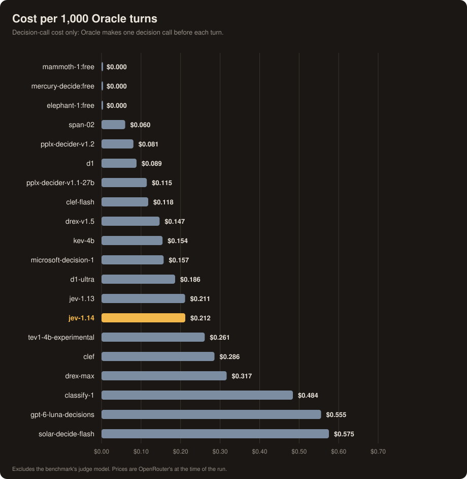
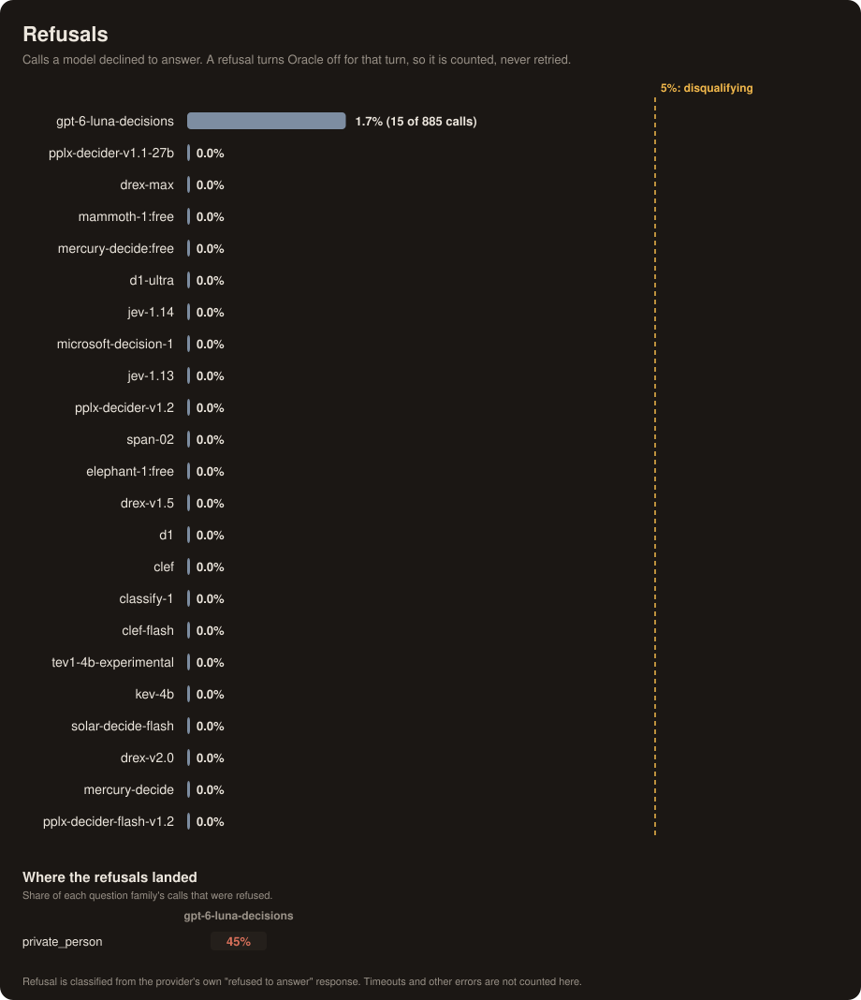
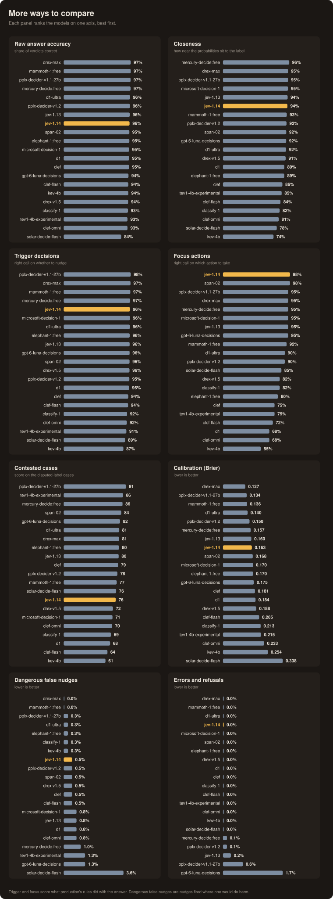
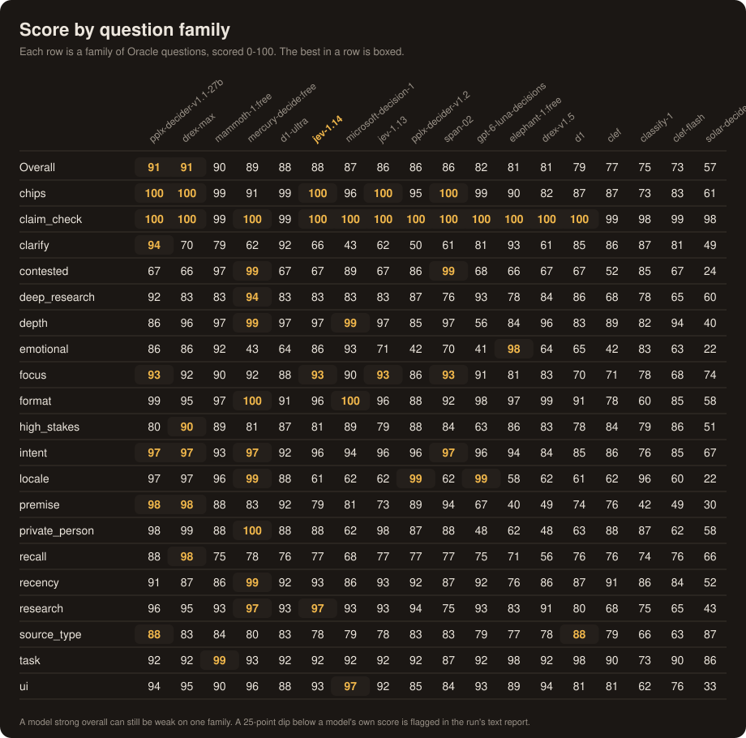
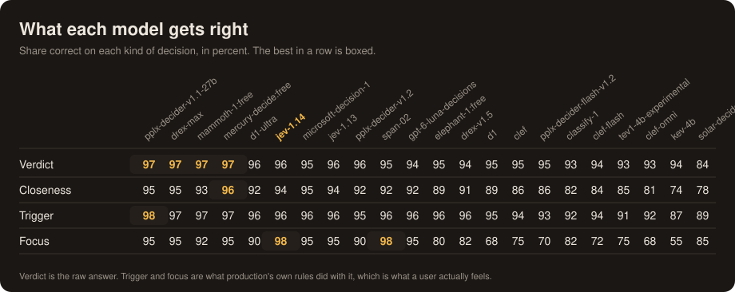

# Oracle decision-model benchmark

Which model should answer Oracle's questions? Oracle mode asks a small, fast **decision model** 22
classification questions before every turn ("does this need fresh data?", "is this about a private
person?", "is the user asking for something deep?") and quietly adjusts how the turn is answered. The
decision model sits in front of every message, so it has to be **fast, cheap, and right**, in that
order.

This page records a full run of `polaris oracle-bench` across seventeen candidate models, and how to
repeat it.

<p align="center"></p>

## The short version

- **Nobody beats Jev 1.14 on the thing that matters most: speed.** Its median call takes 152ms and
  every call finished inside Oracle's real 2.5s timeout. No other model matches both.
- **Perplexity's 27B decider v1.1 is the most accurate model (91.4),** and its lead over Jev 1.14 (87.8) is
  larger than the 2.5-point noise floor. But it takes 2.0s at the median and about **1 in 9 calls
  would miss Oracle's 2.5s cutoff** and silently turn Oracle off for that turn.
- **Perplexity's newer Decider v1.2 trades accuracy for speed:** 86.5, about 5 points below v1.1 (a
  statistical tie with Jev 1.14, not with v1.1), but 871ms at the median instead of 2.0s and about 7% of
  calls past the 2.5s cutoff instead of 11%. It is still far slower than Jev, and it is weak on
  `clarify` (50) and `emotional` (42).
- **Baseten's Mammoth 1 is the best free model: 90.1, 621ms at the median, 99.4% of calls under 2.5s, no
  errors.** Its 2.3-point lead over Jev 1.14 is inside the noise, so it ties Jev on score and is about 4x
  slower at the median, with weaker focus actions (92% vs 98%). It is faster and far steadier than the other
  free option (Mercury free, p95 4.3s), but it is a free tier that can change or disappear, so it is a
  candidate, not a replacement. Its smaller sibling **Elephant 1 scores 81.2** (445ms median, no errors),
  tied with Luna and clearly below Jev, mostly on focus actions (80%) and `premise` (40).
- **Five models are statistically tied with Jev 1.14:** Liquid's **D1 Ultra (87.9)**, Microsoft Decision 1
  (87.5), Jev 1.13 (86.5), Perplexity Decider v1.2 (86.5), and Mercury Decide's free tier (89.0). D1 Ultra is the strongest alternative: the
  same score, 100% of calls under 2.5s, only about 85ms slower at the median, no weak question family,
  and it fixes Jev's weak spot (88 on `locale`, against Jev's 61). It is weaker at focus actions (90% vs
  98%), and that decision changes what Oracle actually does.
- **OpenAI's Luna is fast but a poor fit:** 82.3, 5.5 points behind Jev 1.14, the most expensive
  model per turn (about 2.6x Jev), and the only one that **refuses to answer** some questions: 15
  calls, all on the private-person family. See [Refusals](#refusals).
- **Liquid D1 and both Cloudflare Clef models trail by 9 to 14 points,** mostly on *focus actions*
  (68 to 75% right, against 90 to 98% for the leaders). **Scaledown Classify 1 (75.4) and Upstage Solar
  Decide Flash (57.3) trail further.** Solar Flash is also the closest to a disqualifying 5% of
  dangerous false nudges (4%).
- **Two models couldn't be fully scored:** Nace's Drex 2.0 and Drex Max reject Oracle's 23-question call outright, and
  Upstage's regular Solar Decide takes 13 to 21 seconds per call. See
  [Models that couldn't be scored](#models-that-couldnt-be-scored).
- **Paid Mercury Decide and Perplexity Decider Flash v1.2 could not be benchmarked.** Upstream HTTP 429s
  hit 96% of Mercury's calls and all of Flash's, so both are disqualified for this run. That says nothing
  about their quality; see [Mercury](#mercury-decide) and
  [Perplexity Decider Flash v1.2](#perplexity-decider-flash-v12).

Recommendation: **keep `typesafe/jev-1.14` pinned.** Details and caveats below.

## Results

Runs of 2026-10-16, 2026-10-19 and 2026-10-22: 295 hand-labeled cases (274 count toward the score; 21 with disputed labels are reported
separately), 3 repeats each, 2 calls in flight, weights `a6cbc140bd53`. The raw leaderboards are saved in
[`runs/`](runs/); this table is generated from them ([`results.md`](results.md)). The models ran in six
invocations with identical settings (the first nine models, then Luna, then D1 Ultra, Classify 1 and
Solar Flash, then on 2026-10-19 Perplexity's Decider v1.2 and Flash v1.2, then on 2026-10-22 Baseten's
Mammoth 1 and, separately, Elephant 1, each paced at one call per 3.5s because they are `:free` models; see
[Reproduce it](#reproduce-it)); the report command refuses to merge runs that differ in cases, repeats, concurrency or
weights. The two earlier files in `runs/` (2026-10-15) used an older, smaller case bank and weights, so
they are not comparable to these runs.

| # | Model | Score (95% CI) | Verdict | Trigger | Focus | Danger FP | Errors | p50 | p95 | Under 2.5s | $/1k turns |
|--:|---|---|--:|--:|--:|--:|--:|--:|--:|--:|--:|
| 1 | `perplexity/pplx-decider-v1.1-27b` | **91.4** (87.7-94.4) | 97% | 98% | 95% | 0% | 1% | 2.0s | 3.7s | 88.9% | $0.115 |
| 2 | `baseten/mammoth-1:free` | **90.1** (87.1-92.9) | 97% | 97% | 92% | 0% | 0% | 621ms | 1.1s | 99.4% | free |
| 3 | `inception/mercury-decide:free` | **89.0** (84.0-93.3) | 97% | 97% | 95% | 1% | 0% | 618ms | 4.3s | 87.8% | free |
| 4 | `liquid/d1-ultra` | **87.9** (84.2-91.1) | 96% | 96% | 90% | 0% | 0% | 236ms | 340ms | 100.0% | $0.186 |
| 5 | `typesafe/jev-1.14` (pinned) | **87.8** (83.2-92.0) | 96% | 96% | 98% | 1% | 0% | 152ms | 189ms | 100.0% | $0.212 |
| 6 | `microsoft/microsoft-decision-1` | **87.5** (82.9-91.5) | 95% | 96% | 95% | 1% | 0% | 347ms | 424ms | 100.0% | $0.157 |
| 7 | `typesafe/jev-1.13` | **86.5** (81.4-90.9) | 96% | 96% | 95% | 1% | 0% | 184ms | 272ms | 99.8% | $0.211 |
| 8 | `perplexity/pplx-decider-v1.2` | **86.5** (82.6-90.0) | 96% | 95% | 90% | 1% | 0% | 871ms | 3.7s | 93.0% | $0.081 |
| 9 | `openai/gpt-6-luna-decisions` | **82.3** (76.3-87.5) | 94% | 96% | 95% | 1% | 2% | 243ms | 409ms | 98.3% | $0.555 |
| 10 | `baseten/elephant-1:free` | **81.2** (75.8-86.2) | 95% | 96% | 80% | 0% | 0% | 445ms | 765ms | 98.4% | free |
| 11 | `liquid/d1` | **78.5** (72.7-83.5) | 95% | 95% | 68% | 1% | 0% | 260ms | 411ms | 100.0% | $0.089 |
| 12 | `cloudflare/clef` | **76.6** (71.2-81.3) | 95% | 94% | 75% | 1% | 0% | 820ms | 1.9s | 98.9% | $0.286 |
| 13 | `scaledown/classify-1` | **75.4** (70.6-80.0) | 93% | 92% | 82% | 0% | 0% | 579ms | 1.4s | 97.3% | $0.484 |
| 14 | `cloudflare/clef-flash` | **73.4** (68.2-78.5) | 94% | 94% | 72% | 1% | 0% | 596ms | 1.3s | 100.0% | $0.118 |
| 15 | `upstage/solar-decide-flash` | **57.3** (49.5-64.8) | 84% | 89% | 85% | 4% | 0% | 1.3s | 1.6s | 100.0% | $0.575 |
| x | `inception/mercury-decide` | **4.6** (2.4-7.5) | 4% | 97% | 100% | 0% | 96% | 3.9s | 13.3s | 1.2% | $0.004 |
| x | `perplexity/pplx-decider-flash-v1.2` | not benchmarkable | n/a | n/a | n/a | n/a | 100% | n/a | n/a | n/a | n/a |

*Under 2.5s* is the share of all calls that returned an answer inside Oracle's real timeout
(`oracleTimeout` in `gateway/oracle.go`); a call over that is dropped and the turn runs without Oracle.
*$/1k turns* is the decision-call cost for 1,000 Oracle turns (one call each). Trigger and focus
describe what production's rules *did* with the answer, not just the raw answer. The whole run cost
**$3.02** in total ($1.22 for the first nine models, $0.51 for Luna, $1.18 for the next three, $0.09 for
Perplexity's two new models, and $0.01 each for Mammoth and Elephant, which are free and cost only their
judging), of which about $0.30 was the judge.

### Overall quality

The headline score on its own, with speed deliberately left out.

<p align="center"></p>

The intervals overlap heavily across the top seven. With 274 scored cases, a gap under about 2.5 points is
noise, so the honest reading is four tiers: **Perplexity v1.1, Mammoth and Mercury free** at the top, **D1 Ultra, Jev 1.14,
Microsoft, Jev 1.13 and Perplexity v1.2** tied just behind, **Luna, Elephant, D1, Clef and Classify 1** clearly below, and **Clef Flash
and Solar Flash** at the bottom.

### Accuracy against speed

The chart that decides it. Up is better, left is faster, and the amber line is the 2.5s cutoff Oracle
actually enforces.

<p align="center"></p>

Only Jev 1.14, Jev 1.13, D1 and Microsoft are both fast and consistent: their 95th-percentile call
finishes well under half a second. Perplexity (both versions) and Mercury free have a 95th-percentile call of
3.7s to 4.3s; v1.1 and Mercury free score highest, but their slowest
calls are exactly the ones Oracle throws away.

<p align="center"></p>

### Cost

<p align="center"></p>

<p align="center"></p>

Cost is a rounding error at this scale: even the priciest models (Solar Flash and Luna, about $0.56 to $0.58
per 1,000 turns) cost cents in a heavy month. Note the bills run higher than the catalog's per-token prices
suggest for several models (Classify 1 and Solar Flash especially), so compare the measured figures here, not
the list prices. The frontier is only useful for the free-versus-paid question: Mercury
free and Perplexity v1.1 are the only models nothing beats on both price and score (v1.2 is cheaper than
v1.1 at $0.081, but Mercury free beats it on both counts). Jev 1.14 is off the
frontier on cost, which is the price of its speed.

### Refusals

Some hosted models decline to answer a question outright, and a refused call can't run Oracle: the
turn proceeds with Oracle off. The bench records a refusal as that model's result and never retries it.

<p align="center"></p>

**Only Luna refused anything:** 15 of 885 calls (1.7%), under the 5% disqualification line, so it stays
in the ranking, but every one of those 15 was on the **private-person** family (questions like finding
a classmate, an ex's workplace, a neighbor's phone number, or an HOA head's address). It refused 5 of that
family's 11 cases on all three repeats, which is 45% of the family's calls, and nothing anywhere else. No
other model refused a single call, on this or any other family, so this is a property of Luna's underlying
chat model, not of the question. The error text only names a question key, so which exact question tripped it is
not recorded; what the log does show is the pattern by family. Luna also scores 48 on that family because a
refused call counts as Oracle-off.

Paid Mercury's failures are not refusals: those were upstream 429s and are tracked as errors, not here.

### Every axis

Eight other ways to rank the same run: raw answer accuracy, closeness, trigger decisions, focus
actions, the contested-label cases, calibration, dangerous false nudges, and errors.

<p align="center"></p>

Two details worth knowing. Jev 1.14 is the **best of all fifteen scored models at focus actions (98%)**, which is the
decision that changes what Oracle *does* rather than what it says. And every model but one keeps dangerous
false nudges to about 1% or less. The exception is Solar Flash at 4% (14 of 391 opportunities), close to the 5%
disqualification line.

### Strengths and weaknesses by question family

<p align="center"></p>

<p align="center"></p>

Where a model is unusually weak (25+ points below its own overall score):

- **Jev 1.14:** `locale` (61). Perplexity scores 97 and Mercury free 99 on the same family, so this is
  a real gap rather than a hard question; Jev 1.13, Microsoft, D1 and Clef sit at 60 to 62 too.
- **Microsoft Decision 1:** `clarify` (43), `locale` (62) and `private_person` (62).
- **Mercury free:** `clarify` (62) and `emotional` (43).
- **Perplexity Decider v1.2:** `clarify` (50) and `emotional` (42).
- **Mammoth:** none.
- **Elephant:** `premise` (40).
- **Clef:** `emotional` (42).
- **Luna:** `depth` (56), `emotional` (41) and `private_person` (48, mostly refusals).
- **D1 Ultra:** none. Its lowest families are `emotional` (63) and `contested` (66), both within 25 points of its
  overall score.
- **Classify 1:** `premise` (42).
- **Solar Flash:** `contested` (24), `emotional` (22), `locale` (22) and `premise` (30).

## Recommendation

Judged on the operator's stated priorities (speed first, then accuracy):

1. **Keep Jev 1.14.** It is the fastest model tested, 100% inside the timeout, best at focus actions,
   and tied on score with every model except Perplexity v1.1. The 1.14 over 1.13 gain (87.8 vs 86.5) is
   inside the noise, so the decision to pin 1.14 stands but is not a strong claim.
2. **If Jev ever needs replacing, try D1 Ultra first.** Same score, 100% inside the timeout, about 85ms
   slower at the median, about 12% cheaper, no weak question family, and it handles `locale` far better
   than Jev. The cost is focus actions (90% vs 98%). Microsoft Decision 1 is the next choice (same score,
   cheaper, but weak on `clarify`, `locale` and `private_person`).
3. **Mammoth is the best free option, and a reasonable fallback, not a replacement.** It ties Jev on score
   (90.1 vs 87.8), stays inside the 2.5s timeout on 99.4% of calls, and has no weak question family. It loses
   on speed (621ms against 152ms at the median) and on focus actions (92% vs 98%), and being a free tier it
   can be rate limited or withdrawn without notice. Elephant 1 is not worth considering: 81.2, weak on
   focus actions (80%) and `premise` (40).
4. **Perplexity only wins if Oracle's timeout is raised.** v1.2 is the faster of the two (871ms median,
   about 7% of calls past 2.5s) but gives up the accuracy lead: it ties Jev on score at 6x the median
   latency, so it has no reason to replace Jev. v1.1 is the accurate one. To use v1.1 without dropping turns, the 2.5s
   cutoff would have to rise to roughly 4s, which adds seconds of dead air before every answer. At
   today's 2.5s it would turn Oracle off for about 11% of turns. Not recommended.
5. **Skip Luna.** Fast (243ms median) but 5.5 points behind Jev 1.14, about 2.6x the cost per turn,
   and it refuses the private-person questions Oracle most needs to classify.
6. **Skip D1, the Clef models, Classify 1 and Solar Flash.** D1 and Clef are fast enough but lose 9 to 14
   points, mostly on focus actions; Classify 1 and Solar Flash lose 12 to 30 points, and Solar Flash also
   produces the most dangerous false nudges.

`jev.Model` and `oracleTimeout` were not changed by this run.

### Models that couldn't be scored

- **`nace-ai/drex-v2.0`** fails every call with `HTTP 422: too many questions (23); limit is 16`. It caps a
  single call at 16 questions and Oracle asks 23, so it cannot run Oracle's question set as designed.
  Splitting the questions across several calls would change how Oracle works (more calls, more latency), so
  it was not attempted. `drex-v1.5` was not tried and probably has the same cap.
- **`nace-ai/drex-max`** (Drex 2.0's successor, 2026-10-23, DeepInfra at $0.06/M prompt tokens, about 290ms
  p50 in OpenRouter's own stats) has the same cap: a 12-case smoke test failed every call with
  `HTTP 422: questions must be an object of 1..16 questions`. The 422 comes from the server's request
  validation, so it says nothing about the model's accuracy. Not run in full, for the same reason as 2.0.
- **`upstage/solar-decide`** (the regular, non-Flash model) answers correctly (79.9 on a 6-case probe) but
  takes 13 to 21 seconds per call, about 100x Oracle's 2.5s timeout, and it timed out at the bench's 15s
  limit on most of a 12-case smoke test. It was not run in full: there is no way for it to be usable here.

### Perplexity Decider Flash v1.2

`perplexity/pplx-decider-flash-v1.2` (a 4B-parameter sibling of Decider v1.2, $0.01 per million input
tokens) is **not benchmarkable right now**. Every call, 885 of 885 in the full run and again in a separate
5-call probe, returned `HTTP 429 Token rate limit exceeded` from the upstream provider, so it is shown as
disqualified (100% errors) rather than scored. The model ID is valid (OpenRouter's endpoints API returns
it) and it is not an unsupported-question-format problem; the limit is on the provider side for our
account. That says nothing about its quality, and it was not retried. Like the other decision models it is
hidden from OpenRouter's public `/models` list (output modality `decisions`), so look it up through
`/api/v1/models/perplexity/pplx-decider-flash-v1.2/endpoints`.

### Mercury Decide

Mercury has two entries and neither is a clean result:

- **`inception/mercury-decide`** returned `HTTP 429 rate_limit_exceeded` ("Request or spending limit
  exceeded") on 847 of 885 calls, with the same error in an earlier smoke test. The API key itself had
  plenty of headroom, so the limit is on Inception's side. The 38 calls that did answer are not
  enough to score it. **Re-run it later** before drawing any conclusion.
- **`inception/mercury-decide:free`** answered almost everything (1 error in 885) and scored 89.0, but
  its tail latency is poor (p95 4.3s, about 12% of calls over the timeout). A free tier may also be
  rate limited or withdrawn without notice; that was not investigated here.

## Method

- **Cases.** `oraclebench/cases` holds 295 hand-labeled messages across the question families Oracle
  asks about, including 14 `deep_research` cases. 21 are marked as having genuinely disputed labels and
  are reported separately, so the headline score covers the other 274.
- **Two layers of scoring.** The *raw answer* layer asks whether the model picked the labeled option and
  how close its probabilities were. The *production* layer asks whether production's own firing rules
  then delivered the right nudge or action, because a correct raw answer that does not clear its
  threshold changes nothing for the user, and a quiet option winning is not a delivered nudge.
- **Repeats.** Each case is asked 3 times and the probabilities averaged, since they move by a few
  hundredths from call to call.
- **Fixed load.** Models run one after another with 2 calls in flight, so every model is timed under
  the same load. Latency moves with provider load, so treat it as one day's measurement.
- **Judge.** A separate chat model (`deepseek`) reads the disputed cases, near-misses, and a 10% random
  spot-check of ordinary answers. Across the three runs' 477 spot-checks (318, 41 and 118) it disagreed with the hand label 3 times
  (0.6%), which is the best available estimate of how wrong the bank is. It flagged
  `dr-remote-work-relocation`, `fo-researcher-loan-vs-index`, `pr-followup-japan-crowds` and
  `hs-first-ipo-trivia` for a human look.
- **Weights.** Scoring weights and the 5s latency budget live in
  [`oraclebench/weights.yaml`](../../../oraclebench/weights.yaml). The 5s budget is deliberately looser
  than the 2.5s production timeout, which is why the timeout share is reported separately.
- **Failures are results.** A refusal or timeout is recorded against the model and never retried. A
  model over 5% errors or over 5% dangerous false nudges is disqualified.

## Caveats

- The case bank is synthetic and hand-labeled by one operator, so it measures agreement with one
  person's idea of the right answer. The judge found 1% disagreement, not zero.
- Three repeats and 274 scored cases give intervals of about plus or minus 4 points. Do not read ranks inside
  a tier as meaningful.
- Latency was measured once, on one day, at concurrency 2.
- Some `prompts.yaml` options genuinely overlap (`brief` vs `off`, `legal` vs `financial`), so a few
  labels are ambiguous by construction. Changing them changes live Oracle behavior, so they were left
  alone.

## Reproduce it

```bash
# one invocation so every model sees the same cases, weights and load
# (Luna, then D1 Ultra, Classify 1 and Solar Flash, then perplexity/pplx-decider-v1.2 and
# perplexity/pplx-decider-flash-v1.2, were later invocations with the same flags)
polaris oracle-bench --repeats 3 --seed 1 --concurrency 2 --timeout 15s \
  --label "full run" \
  --models typesafe/jev-1.14,typesafe/jev-1.13,liquid/d1,microsoft/microsoft-decision-1,cloudflare/clef-flash,cloudflare/clef,inception/mercury-decide,inception/mercury-decide:free,perplexity/pplx-decider-v1.1-27b

# regenerate every chart and results.md from the saved leaderboard
polaris oracle-bench report \
  --run docs/benchmarks/oracle-decision-models/runs/<first>.json,docs/benchmarks/oracle-decision-models/runs/<second>.json,... \
  --calls 'oraclebench/results/*-calls.jsonl'
```

`:free` models are paced automatically (`--free-interval`, default 3.5s between calls, about 52 minutes
for a full run). OpenRouter limits free models to roughly 20 calls a minute across the whole account, and
the bench never retries a 429, so an unpaced free model is disqualified for our account's limit rather than
its own quality. There is also a daily cap of 1000 free-model requests (`GET /api/v1/key` reports
it as `free_model_daily_requests`). **It is per OpenRouter account, not per key**: a second key on the same
account showed the same used count. A full run is 885 calls, so run one free model per day per account.
Elephant 1 ran the same day as Mammoth using a key from a separate account (`--config` pointed at a
throwaway config holding it), which only changes whose free-model quota is spent, not the model, cases or
settings. The wait is outside the latency timer, so
it does not affect measured latency.

`--calls` **rewrites `call-stats.json` from only the logs it matches**, and those raw logs are gitignored, so
a fresh checkout has only the latest run's. When adding a model, tally just its own log, then merge the new
entries into the committed `call-stats.json` by hand and re-run `report` *without* `--calls`; passing the
glob against a partial set of logs silently drops every other model's timeout and refusal share.

The run saves its leaderboard to `runs/` on its own, and `report` saves the per-model call tallies (timeout
share, refusals by family) to `call-stats.json` so charts can be rebuilt without the raw log. Do not edit `prompts.yaml` or pull while a run is
in flight, because it hot-reloads and would change the questions for the remaining calls. About 8,000
calls take roughly 50 minutes plus a judging pass, and cost about $1.20. Design notes and the scoring
rules are in [`docs/plans/oracle-benchmark.md`](../../plans/oracle-benchmark.md); how to write cases is
in [`oraclebench/AUTHORING.md`](../../../oraclebench/AUTHORING.md).
