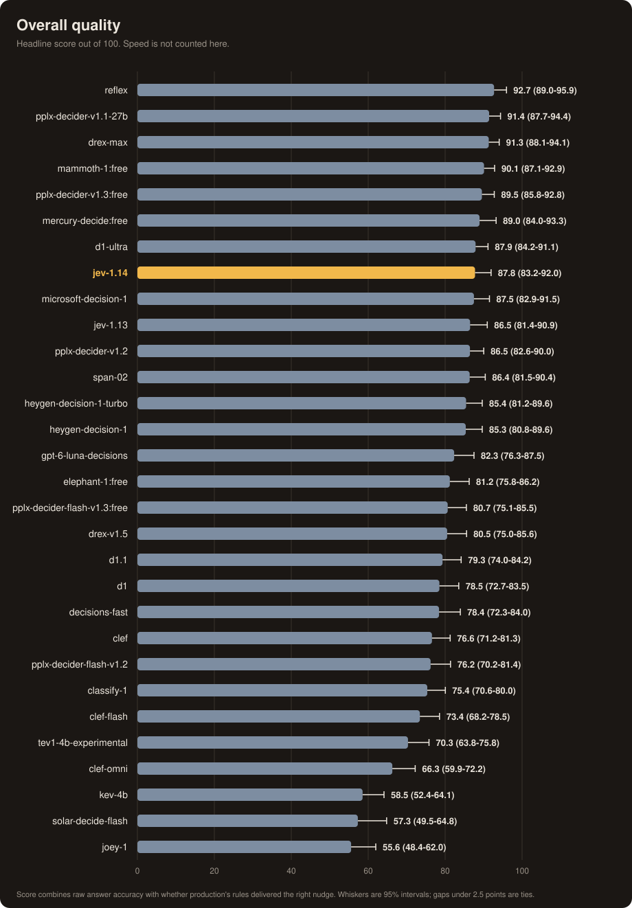
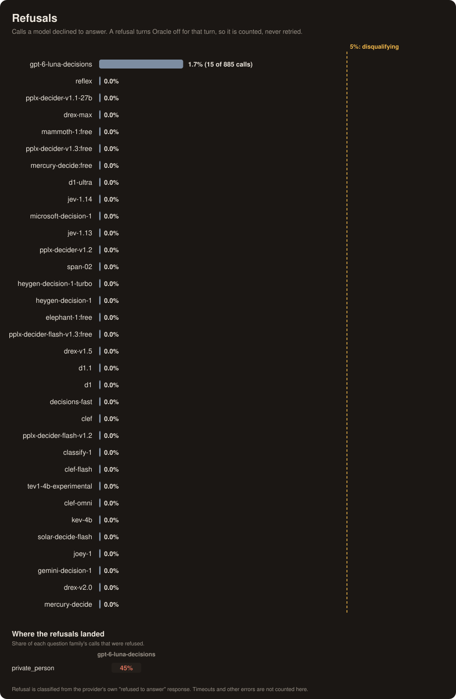
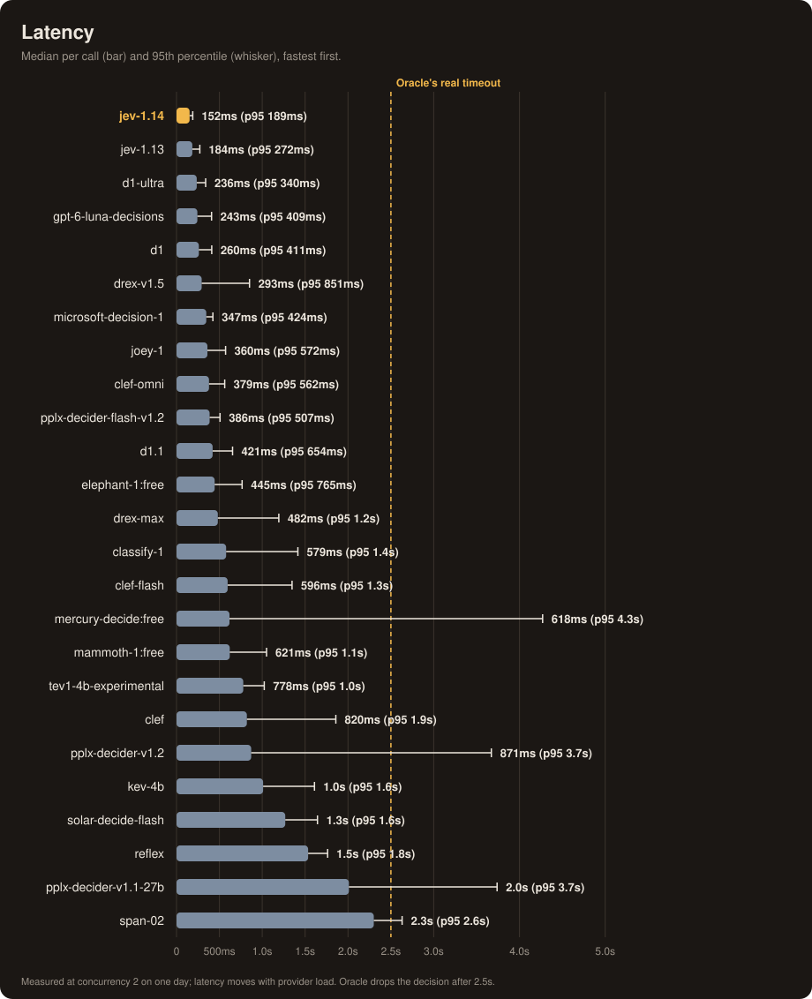
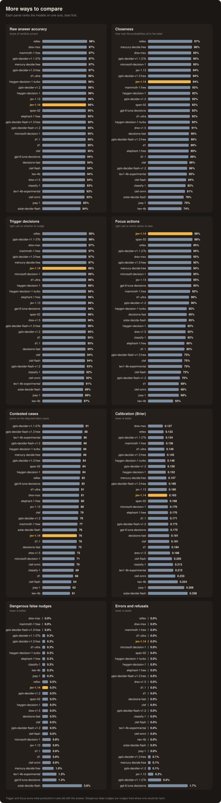
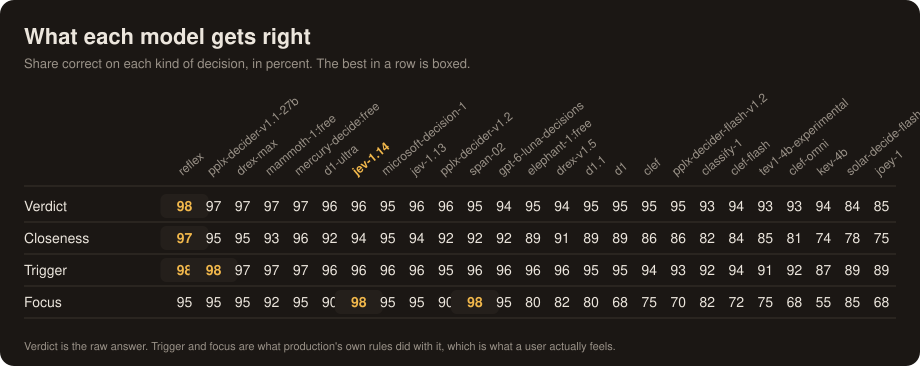
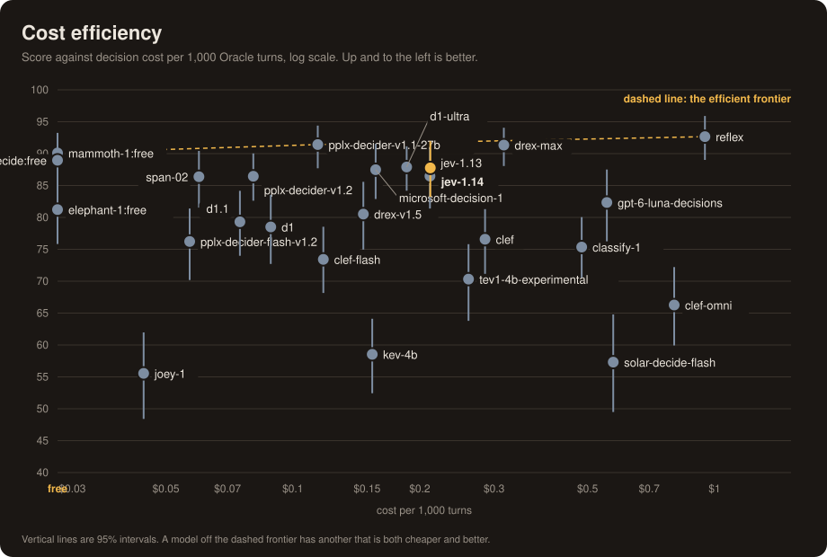

# Oracle decision-model benchmark: notes

The detail behind [README.md](README.md)'s table: what each model does well and badly, the question-cap
workaround, the models that could not be scored, and how the run was made. The recommendation lives in
the README; this page is for when a row needs explaining.

Catalog and availability notes here were checked live on **2026-11-13**.

## Runs

Twenty-two invocations of `polaris oracle-bench`, 2026-10-16 to 2026-11-13, all with `--repeats 3 --seed 1
--timeout 15s` and 2 calls in flight except where noted. The report command refuses to merge runs that
differ in cases, repeats or weights, and in concurrency unless given `--allow-concurrency-mismatch`, which
marks the affected rows (†) — accuracy is unaffected by concurrency, latency is not.

- **2026-10-16** — the first nine: Jev 1.14, Jev 1.13, D1, Microsoft Decision 1, Clef Flash, Clef,
  Mercury paid, Mercury free, Perplexity v1.1.
- **2026-10-19** — Luna; then D1 Ultra, Classify 1 and Solar Flash.
- **2026-10-19** — Perplexity v1.2 and Flash v1.2.
- **2026-10-22** — Mammoth, then Elephant, separately, each paced at one call per 3.5s because they are
  `:free` models. Elephant used a throwaway config with a key from a separate account, which only changes
  whose free-model quota is spent.
- **2026-10-25** — Span-02.
- **2026-10-26** — the three Drex models at `--concurrency 1`; then Tev1 and Kev; then Clef Omni; then a
  re-run of Flash v1.2 after its first attempt hit upstream 429s on every call.
- **2026-10-27** — D1.1. **2026-10-30** — Joey 1.
- **2026-11-04** — Reflex, twice: the first run, then a second to capture per-call cost and token
  accounting. The second is the row in the table.
- **2026-11-06** — Parallel's Decisions Fast.
- **2026-11-11** — `google/gemini-decision-1`, four attempts: two at concurrency 2, then two at concurrency
  1 once the first pair had lost a third of its calls to 429s. All four are disqualified; the row in the
  table is the best of them. See [the shared Google
  quota](#gemini-decision-1-and-the-shared-google-quota).
- **2026-11-13** — `perplexity/pplx-decider-v1.3:free`, `heygen/heygen-decision-1` and `-turbo` in one
  invocation, then `perplexity/pplx-decider-flash-v1.3:free` in a second run **on a key from a separate
  account** — the free-model quota is per account, and both free builds in one day would not fit under
  1,000 calls. See [the v1.3 pair](#perplexity-v13-and-the-heygen-pair).

The two earliest files in `runs/` (2026-10-15) used an older, smaller case bank and older weights, so
they are not comparable and do not appear in the table.

## Per-model notes

Ranked by score. "Weak families" means 25 or more points below that model's own overall score; a track's
score is credit earned minus penalties, so it can go negative.

- **`morph/reflex` (92.7)** — the top score, from two separate runs on the same day (92.66 and 92.71,
  overlapping intervals). Takes all 23 questions in one request, no cap, no errors, no refusals in 885
  calls, 1.5s median, 1.8s p95, $0.902 per 1,000 turns. Weak on `emotional` (43): it fires the nudge on
  both hyperbole traps — furious about a lost bag, "so stressed" about a wedding font — where the label
  says no. Next weakest are `clarify` (71) and `recall` (78); everything else is 92 or better.
- **`perplexity/pplx-decider-v1.1-27b` (91.4, retired)** — the accurate Perplexity build: 2.0s median,
  3.7s p95, only 88.9% of calls inside Oracle's cutoff (about 1 in 9 turns would silently lose Oracle),
  $0.115 per 1,000 turns. It scored 97 on `locale`, where Jev manages 61. Gone since 2026-10-26
  (`HTTP 404 No endpoints found`); the row is a record.
- **`nace-ai/drex-max` (91.3)** — the most accurate model still callable below Reflex: 482ms median, 1.2s
  p95, 99.4% inside the cutoff, 0 errors, $0.317 per 1,000 turns, weak on `contested` (66) and focus
  actions 95% against Jev's 98%. Three caveats on the number: it was scored under a two-request split
  ([below](#models-with-a-question-cap)), its latency was measured at concurrency 1, and its provider has
  not been load-tested the way Jev's has.
- **`baseten/mammoth-1` (90.1)** — the best free build at the time: 621ms median, 1.1s p95, 99.4% inside
  the cutoff, no errors, no weak family, focus actions 92%. Ties Jev on score only because its 2.3-point
  lead is inside the noise, and it is 4x slower at the median. It ran as `:free`, which Baseten has since
  replaced with a paid build at $0.10/M — and a free tier can also be rate limited or withdrawn without
  notice, which is exactly what happened.
- **`perplexity/pplx-decider-v1.3:free` (89.5)** — the best free build still callable, and a statistical tie
  with the pin at $0: 555ms median, 1.3s p95, 99.2% of calls inside the cutoff, focus actions 95%, no weak
  family by the 25-point rule but `clarify` (60), `contested` (66) and `emotional` (64) are its soft spots
  in that order. 3.9k input tokens a call, so it is also cheap on the tokenizer side. What keeps it off the
  pin is the tail, not the score: one call took 10.2s and four more passed 3s, where Jev has none, and it
  is 3.6x Jev's median in front of every turn. That tail is worth expecting rather than treating as a
  glitch — pplx-decider-v1.2 had the same 3.7s p95. See [the v1.3 pair](#perplexity-v13-and-the-heygen-pair).
- **`inception/mercury-decide:free` (89.0, retired)** — 618ms median, 0 errors, focus actions 95%, $0 —
  but p95 4.3s, so about 12% of calls missed the cutoff, and weak on `clarify` (62) and `emotional` (43).
  Both Mercury entries now return `HTTP 404 No endpoints found` (2026-11-10).
- **`liquid/d1-ultra` (87.9)** — the strongest alternative to Jev: same score inside the noise, 236ms
  median, 340ms p95, 100% inside the cutoff, about 12% cheaper, no weak family (lowest are `emotional`
  63 and `contested` 66), and it fixes Jev's `locale` blind spot. The cost is focus actions: 90% against
  98%.
- **`typesafe/jev-1.14` (87.8)** — pinned. 152ms median, 189ms p95, every call inside the cutoff, the best
  focus actions of all 30 scored models (98%), $0.212 per 1,000 turns. Weak on `locale` (61); Jev 1.13, Microsoft,
  D1 and Clef sit at 60 to 62 on the same family too, while Perplexity reaches 97 and Mercury 99, so it is
  a real gap rather than a hard question.
- **`microsoft/microsoft-decision-1` (87.5)** — 347ms median, 100% inside the cutoff, cheaper than Jev.
  Weak on `clarify` (43), `locale` (62) and `private_person` (62).
- **`typesafe/jev-1.13` (86.5)** — the build Jev 1.14 replaced. 184ms median, 99.8% inside the cutoff. The
  1.14-over-1.13 gain is inside the noise, which is why the pin took the later build rather than "the
  better one".
- **`perplexity/pplx-decider-v1.2` (86.5)** — 871ms median, but p95 3.7s and 7% of calls past the cutoff.
  Weak on `clarify` (50) and `emotional` (42). Ties Jev on score at 6x the latency, so it has no reason to
  replace it.
- **`respan/span-02` (86.4)** — a statistical tie with Jev and the cheapest paid model ($0.060 per 1,000
  turns), with the same 98% focus actions. Median call 2.3s and p95 2.6s, so about 14% of turns would run
  without Oracle; its lowest families (`clarify` 61, `locale` 62) are just inside the 25-point line.
  Respan's older `span-01` family cannot run at all — see [below](#models-that-couldnt-be-scored).
- **`heygen/heygen-decision-1-turbo` (85.4) / `heygen/heygen-decision-1` (85.3)** — a tie with each other,
  2.4 points behind Jev, at 425ms and 600ms median and 100% inside the cutoff. Focus actions are the gap
  that matters — 85% and 82% against Jev's 98% — along with `clarify` (61 to 65), `private_person` (62) and
  `contested` (65 to 66). Both bill 10.4k to 10.9k input tokens for the same 23 questions Perplexity fits in
  3.9k, which is where their $0.98 and $1.46 per 1,000 turns come from: the catalog price ($0.09/M and
  $0.14/M) is not the reason. Turbo bills *more* tokens than the full build and is only 175ms faster, so
  the pair is one model in two shapes rather than a speed/accuracy choice.
- **`openai/gpt-6-luna-decisions` (82.3)** — fast (243ms) but the most expensive per turn ($0.555),
  behind Jev on score, and the only model that **refuses** to answer (see [Refusals](#refusals)). Weak on
  `depth` (56), `emotional` (41) and `private_person` (48, mostly the refusals).
- **`baseten/elephant-1` (81.2)** — 445ms, no errors, tied with Luna; weak on `premise` (40) and focus
  actions (80%). Also `:free` when run, now paid at $0.035/M.
- **`perplexity/pplx-decider-flash-v1.3:free` (80.7)** — the fastest model tested (256ms median, 444ms p95,
  100% inside the cutoff) with no errors, and 7 points behind Jev. `premise` 31 is the lowest family score
  on the page, with `locale` 61 next and focus actions 75%. Its eight-case smoke said 97; the full bank
  said 80.7, which is the case for smoking on more than eight cases before writing anything down.
- **`nace-ai/drex-v1.5` (80.5)** — fast (293ms, no question cap, single request) but 7 points behind Jev,
  mostly on focus actions (82%), `premise` (49) and `private_person` (48).
- **`google/gemini-decision-1` (80.3, disqualified)** — the calls that answered were quick (402ms median,
  643ms p95, every one inside 2.5s) and scored 80.3, which is 7.5 points behind Jev and 2.6x its median
  latency for $0.40 a turn against $0.212. Only 81.4% of calls answered at all — OpenRouter's shared
  Google quota 429s in bursts — so the score above is what it managed on the calls that got through. Weak
  on `high_stakes` (53) and `deep_research` (64) in this run; across the four attempts the low family
  moves around — `private_person` 40, `contested` 36, `depth` 41, `recency` 28 — because which calls the
  limiter erased differs each time. Only `high_stakes` is low in more than one attempt (48 and 53). Its
  best family is `locale` (99.5), the exact place Jev is weakest (61).
- **`liquid/d1.1` (79.3)** — a tie with the D1 it replaces (78.5) and not a step toward D1 Ultra. Cheaper
  ($0.075 against $0.089) and better at focus actions (80% against 68%), but ~160ms slower at the median
  and still 8.5 points behind Jev, with weak `locale` (61), `private_person` (62), `contested` (64),
  `emotional` (64) and `premise` (64). All 885 calls inside the cutoff.
- **`liquid/d1` (78.5)** — 260ms median, all calls inside the cutoff, but focus actions right only 68% of
  the time and 9 points behind Jev. Still listed as of 2026-11-10, beside `d1.1`.
- **`parallel/decisions-fast` (78.4)** — see [the section below](#parallel-decisions-fast-web-grounded);
  the only model here that researches the live web before answering.
- **`cloudflare/clef` (76.6)** — 820ms, 98.9% inside the cutoff, weak on `emotional` (42) and focus
  actions (75%); 12 points behind Jev for 1.35x the price.
- **`perplexity/pplx-decider-flash-v1.2` (76.2)** — see [its own section](#perplexity-decider-flash-v12).
- **`scaledown/classify-1` (75.4)** — 579ms, 97.3% inside the cutoff, weak on `premise` (42), and one of
  the most expensive models tested ($0.484 per 1,000 turns).
- **`cloudflare/clef-flash` (73.4)** — 596ms, every call inside the cutoff, focus actions 72%.
- **`togethercomputer/tev1-4b-experimental` (70.3)** — 778ms, no errors, no question cap; weak on `premise`
  (26) and `private_person` (38). At 4B parameters the failure is accuracy, not compatibility.
- **`cloudflare/clef-omni` (66.3)** — the second-priciest model tested, behind only Reflex ($0.802 per 1,000 turns, 3.8x Jev).
  Fast (379ms) but badly wrong on `premise` (16); it is the multimodal variant and Oracle sends only text.
- **`nace-ai/drex-v2.0` (64.7, disqualified)** — 22% errors, all upstream `429 Model busy`. See [Drex
  2.0's errors](#drex-20s-errors-trace-to-the-provider).
- **`jaredpalmer/kev-4b` (58.5)** — 1.0s, no errors, focus actions right only 55% of the time, weak on
  `depth` (33).
- **`upstage/solar-decide-flash` (57.3)** — 12 to 30 points behind Jev, and the model closest to a
  disqualifying share of dangerous false nudges (4%, 14 of 391 opportunities, against the 5% line). Weak on
  `contested` (24), `emotional` (22), `locale` (22) and `premise` (30).
- **`baseten/joey-1` (55.6)** — fast (360ms), every call inside the cutoff, and the cheapest model at
  $0.044 per 1,000 turns, but 32 points behind Jev. Weak on `clarify` (20), `contested` (11), `premise`
  (-11) and `locale` (-40): the two negatives are real, and mean the penalties on those families
  outweighed the credit earned. A 2B model (Base Labs, on Qwen3.5-2B), released 2026-10-29.
- **`inception/mercury-decide` (4.6, disqualified, retired)** — 96% errors; the same build as the free
  tier, so nothing is missing from the table. See [Mercury](#mercury-decide).

<p align="center"></p>

## Models with a question cap

Nace's Drex 2.0 and Drex Max reject any request with more than 16 questions, and Oracle asks 23. Sent as
one request, they fail every call with `HTTP 422: too many questions (23); limit is 16` (2.0) or
`HTTP 422: questions must be an object of 1..16 questions` (Max). A probe on 2026-10-25 put the limit at
exactly 16 (16 passes, 17 fails). **Drex 1.5 has no cap:** it accepted 23 questions in one request. (An
earlier version of this page guessed it would be capped, without having tried it. Drex Max Finance, the
finance-tuned sibling added 2026-11-10, also accepts 23 — but it is not a candidate; see the
[plan doc](../../plans/oracle-benchmark.md).)

So for 2.0 and Max the bench splits the call: `jev.Client.WithMaxQuestions` cuts it into two balanced
requests (12 and 11 questions, sorted by key so the split is identical every time), sends them
concurrently, merges the answers, sums the cost, and fails the whole call if either request fails, as an
unsplit call would. `oraclebench.MaxQuestionsFor` lists the capped models.

| Model | Score | p50 | Under 2.5s | Errors | Cost per 1,000 turns |
|---|--:|--:|--:|--:|--:|
| `nace-ai/drex-max` (split) | **91.3** | 482ms | 99.4% | 0% | $0.317 |
| `nace-ai/drex-v1.5` (single request) | **80.5** | 293ms | 99.9% | 0% | $0.147 |
| `nace-ai/drex-v2.0` (split) | 64.7, disqualified | 769ms | 77.9% | 22% | $0.173 |

Read the split models with three caveats:

- **The split is not perfectly lossless.** In the 2026-10-25 probe, a question's probability moved when
  its neighbours changed: usually under 0.01, but `emotional` moved 0.08 on Max (0.350 to 0.271) between
  an 8-question and a 16-question request. Repeated identical calls agreed exactly, so the 3 repeats did
  not average anything out. The scores here are for Drex under this particular split.
- **Latency is the slower of two requests**, so tail latency is worse than a single call's, and the run
  used concurrency 1 (twice the load per call at 2), so the latency columns are a best case against the
  other models.
- **Production would need the same cap** (`WithMaxQuestions(16)` on Oracle's client) if a split Drex ever
  won.

### Drex 2.0's errors trace to the provider

193 of Drex 2.0's 885 calls failed. The 91 that were logged cleanly are `HTTP 429: Model busy, retry
later`, an upstream capacity error of the same kind that disqualified paid Mercury and Flash. The other
102 were logged as `context canceled`, which was a bug in the first version of the splitter: when one
request failed it cancelled the other, then reported the first error in request order, so the cancelled
sibling's error hid the real one. That is fixed (the real error is now recorded before the cancel, with a
regression test), but the full run predates the fix. A 60-call re-sample with the fix showed only genuine
429s (3% of calls) and a score of 66.2, so 2.0 is weak even when the provider is not busy. Max and 1.5
had no errors at all, so their numbers are unaffected.

## Models that couldn't be scored

- **`respan/span-01`, `span-01-lite` and `span-01-lite:free`** reject every Choice question with
  `HTTP 400: Respan only accepts noul questions whose instructions and criteria are plain strings`
  (re-verified live 2026-10-25). Span-01 is a behavior scorer that takes only free-text `noul` questions,
  and Oracle is 100% Choice, so these three are N/A rather than scored zero. The catalog lists them at
  `context_length` 0. Respan's newer **Span-02** (released 2026-10-15) is a different product that does
  accept Choice questions and is scored above.
- **`upstage/solar-decide`** (the regular, non-Flash model) answers correctly (79.9 on a 6-case probe) but
  takes 13 to 21 seconds per call, about 100x Oracle's 2.5s timeout, and it timed out at the bench's 15s
  limit on most of a 12-case smoke test. A re-check on 2026-10-26 was somewhat faster but still hopeless:
  8 of 8 calls succeeded at 10.0 to 12.1s each (median 10.7s, 4 to 5x Oracle's timeout and double the
  bench's 5s budget), with a smoke score of 98.1 on those 8 cases, so the model looks accurate and simply
  too slow. It was not run in full: there is no way for it to be usable here.
- **`cloudflare/clairic`** is not a decision model at all, so there is nothing here to benchmark and no
  version of this bench that would fit it. It shows up in the decisions catalog because that filter is on
  `output_modalities`, but it serves only `/api/alpha/extractions`: you hand it a schema of typed fields
  and it extracts, computes and forecasts values into them (Cloudflare's description: extraction over a
  text state plus optional images). Oracle is 100% Choice questions — "pick one of these options" — which
  is a different surface with a different response shape. Listed here only so a later catalog review does
  not rediscover it and queue a pointless run.

## Refusals

Some hosted models decline to answer a question outright, and a refused call can't run Oracle: the turn
proceeds with Oracle off. The bench records a refusal as that model's result and never retries it.

<p align="center"></p>

**Only Luna refused anything:** 15 of 885 calls (1.7%), under the 5% disqualification line, so it stays in
the ranking, but every one of those 15 was on the **private-person** family (questions like finding a
classmate, an ex's workplace, a neighbor's phone number, or an HOA head's address). It refused 5 of that
family's 11 cases on all three repeats, which is 45% of the family's calls, and nothing anywhere else. No
other model refused a single call, on this or any other family, so this is a property of Luna's underlying
chat model, not of the question. The error text only names a question key, so which exact question tripped
it is not recorded; what the log does show is the pattern by family. Luna also scores 48 on that family
because a refused call counts as Oracle-off.

Paid Mercury's failures are not refusals: those were upstream 429s and are tracked as errors.

## Why Reflex costs more than its list price

Reflex lists the same $0.042/M input as Jev, so the catalog says they should cost the same. The measured
figure is about 4.5x. The reason is the **token count, not the cache** — Morph's prefix caching is real,
and 95% of the payload bills at the cached rate. Both runs record the whole accounting per call:

| measured on the real 23-question payload | Reflex | Jev 1.14 |
|---|--:|--:|
| input tokens per call | 92,564 | 4,788 |
| of which billed as cache hits | 87,806 (94.9%) | — (not reported) |
| cost per 1,000 turns | $0.902 | $0.212 |

The arithmetic closes exactly: 87,806 cached tokens x $0.008/M plus 4,758 uncached x $0.042/M is
$0.000902 per call, which is the measured $0.902 per 1,000. So the cache is doing its job and taking almost
everything at a fifth of the input rate; the payload is simply **19x bigger** for the same question set
(its tokenizer runs about 6.4 tokens per character, where ordinary text is nearer 0.25). A fivefold
discount on a 19x bill still lands at 4.5x the price.

One thing the cache does *not* buy: caching the **state** separately. Even a brand-new state is 90-95%
cached on arrival, which means what the prefix covers is the shared question preamble — the same for every
call either way — not the message being classified. That is also why repeats of one state add so little.

**The $/1k column is the production basis now**, not an average over repeats. On the first Reflex run,
repeats 2-3 billed 12.6% less than the first send of a state, so the old all-call average read $0.949 where
a production turn cost $1.028. The rerun showed **no** repeat discount at all (0.0%, $0.902 either way),
which says that 12.6% was the provider's cache warming up during that run rather than a systematic
per-repeat saving. Two honest consequences: treat a single run's cost figure as one measurement (the two
Reflex runs differ by 14% for identical calls), and treat a § in the table as "this row's cost is the old
average over repeats, because that run predates per-call cost capture" — re-running it replaces the mark
with the production figure.

**The two runs also disagree about the tail, which matters more than the cost.** Run 1 never passed 2.29s
(0 of 885 calls over the 2.5s cutoff); run 2 put 5 of 885 over it, worst 3.8s (99.4% inside). So "100%
inside the timeout" was a one-day claim, and the honest summary is "usually in time, occasionally not" —
where Jev has two seconds of headroom on every call. This is the single number to watch if Reflex is ever
swapped in.

<p align="center"></p>

## Parallel Decisions Fast (web-grounded)

`parallel/decisions-fast` (build `parallel/decisions-fast-20261106`, released 2026-11-06) **scores 78.4**
(72.3-84.0): 9.4 points behind Jev 1.14, well past the noise floor, so it is not a candidate. It is still
the row worth reading here, because it is the only model in this table that does not answer from the
message alone.

**It researches the live web before answering.** Parallel's description says it reads the `state` you pass
and then searches, and the API confirms it: a one-question probe against the state "what is the price of
bitcoin right now" came back with **ten `url_citation` annotations** (Google Finance, bitcoin.org,
Coinbase, Bitget, JM Bullion…) and 3,287 input tokens for a question about the message that needed none of
that content. Every one of the bench's 885 calls carried a page of fetched material with it: **7,134 input
tokens per call, against Jev's measured 4,788** for the identical 23 questions. That extra half of the
payload is web content, paid as input tokens on every turn.

Otherwise it is compatible as-is: it took all 23 questions in one request (the catalog allows up to 100, so
no cap and no split), refused nothing, errored on nothing, and stayed inside Oracle's 2.5s cutoff on 883 of
885 calls. The two that missed are the reason not to trust it, though: **14.92s and 14.93s**, the slowest
calls in the whole table, close enough to the bench's own 15s limit that a longer research tail would have
timed out outright. Jev's slowest call across the whole bank was 572ms, and its 95th percentile 189ms.

What its weak families say is that the research gets in the way of reading the message:

- **`premise` (20)** — 4 of its 13 premise cases answer `no` where the label wants `yes` (the knuckles, the
  landlord deposit, the sky that isn't green at night, the glass-sagging follow-up), each with under half
  its probability on the labeled answer (0.15 to 0.44). It is judging the world the web describes rather
  than the belief in the user's message.
- **`locale` (40)** — it fires the region/spelling nudge on "What is the minimum wage in Portland, Oregon
  right now?", where the place is already stated and the label is `no`.
- **`private_person` (62)** and **`contested` (66)** trail its own average by 15 points or more.
- **A model that researches also thinks the assistant doesn't need to.** It delivered the "no fresh data
  needed" hint on the sertraline-cold-turkey and Tylenol-plus-NyQuil cases, where the label is
  `research: yes` — having just read the web, it concludes nothing more is required. That is the same
  mechanism that makes it a poor fit for Oracle in principle: its job is to judge the message, and it keeps
  doing someone else's job first.

Two things to know before it could ever be pinned:

- **It would send every message to a search pipeline.** Oracle runs before every turn, so this model in
  production means every message the operator types goes into Parallel's live-web research, not just into a
  classifier. The other 27 models see the message and the question set and nothing else. That is a product
  decision disguised as a model choice.
- **Its row is not reproducible, and its citations are currently thrown away.** Answers depend on today's
  web, so this is a 2026-11-06 measurement, not a repeatable one — re-running the same 295 cases on another
  day would give a different number in a way no other row here does. And `decisions.Response` has no field
  for `annotations`, so neither the gateway nor the bench ever sees the citations the provider returns; if
  this model were ever adopted, its sources would need decoding before they were of any use.

Cost: OpenRouter billed **$0.000** for all 885 calls (every `usage.cost` and `cost_details` field came back
zero), so the column marks it ‡ rather than reusing the free models' figure. At the catalog's $0.130 per
million input tokens and its measured 7,134 tokens a call it would be about **$0.93 per 1,000 turns** —
second only to Clef Omni, and not a cheap model at all. The catalog has since swapped which side is free:
the paid id this run used is gone as of 2026-11-10 and `parallel/decisions-fast:free` is what remains.

## Perplexity Decider Flash v1.2

`perplexity/pplx-decider-flash-v1.2` (a 4B-parameter sibling of Decider v1.2, $0.01 per million input
tokens) **scores 76.2** (70.2-81.4): 386ms median, 507ms p95, 99.5% of calls under 2.5s, no errors, about
$0.057 per 1,000 turns. That is 11 points behind Jev 1.14, weak on focus actions (70%) and `premise` (36),
so it is not a candidate, but it is one of the cheapest models tested.

It was first run on 2026-10-19 and every call, 885 of 885, plus a separate 5-call probe, returned
`HTTP 429 Token rate limit exceeded` from the upstream provider, so it was recorded as disqualified (100%
errors). That was the provider's limit on our account, not the model or the question format. On 2026-10-26
a 12-call smoke test succeeded and the full run was repeated with identical settings; it replaced the
failed entry (the 2026-10-19 file in `runs/` still holds the failed attempt). Like the other decision
models it is hidden from OpenRouter's public `/models` list (output modality `decisions`), so look it up
through `/api/v1/models/perplexity/pplx-decider-flash-v1.2/endpoints`.

## Perplexity v1.3 and the HeyGen pair

Four entries arrived on 2026-11-12 and were benched on 2026-11-13 (build suffix `-20261112`):
`perplexity/pplx-decider-v1.3` and its `-flash` sibling, both `:free`, and `heygen/heygen-decision-1` with a
`-turbo` sibling. None of them needed a question cap, none refused anything, and none errored beyond a
single 429 (below), so all four take Choice questions in one request like Jev does.

**`perplexity/pplx-decider-v1.3:free` (89.5, 85.8-92.8)** is the result worth the run: 555ms median, 1.3s
p95, 99.2% of calls inside the 2.5s cutoff, focus actions 95%, $0. It ties the pin within the noise and
replaces `baseten/mammoth-1` as the best free build measured. Two things keep it off the pin. The tail:
one call took 10.2s, four more passed 3s, and five of 884 answered past the cutoff — the pin has none of
that, and a decision model sits in front of every turn. And the family shape: it is the mirror of Jev rather
than an upgrade, soft on `clarify` (60), `emotional` (64) and `contested` (66) where Jev is 95 to 98, and
strong on `claim_check`, `chips` and `research` (99 to 100) where Jev is 90. Its tokenizer is also
uncharacteristically good: 3.9k input tokens per call, the same as v1.2 and a third of the HeyGen pair's.

**`perplexity/pplx-decider-flash-v1.3:free` (80.7, 75.1-85.5)** is the fastest model on the page — 256ms
median, 444ms p95, every call inside the cutoff — and 7 points behind Jev. `premise` 31 is the lowest
family score measured on any model, with `locale` 61 behind it and focus actions 75%. An eight-case smoke
put it at 97; the full bank put it at 80.7. Small-sample smokes are for compatibility and cost, not for
ranking.

**The HeyGen pair (85.4 turbo, 85.3 full)** ties each other and sits 2.4 points behind Jev, with the two
weaknesses that matter for Oracle: focus actions at 85% and 82% against 98%, and a tail that is fine
(100% inside the cutoff) at a median 2.8x Jev's. The reason to rule them out is the bill, and the bill is
not the catalog price: both send 10.4k to 10.9k input tokens for the same 23 questions (turbo sends
*more* than the full build), which turns $0.09/M and $0.14/M into $0.98 and $1.46 per 1,000 turns, 5 to
7 times the pin. A low per-token price on a model that reads the question set twice as expensively is not
a saving, and only the measured call shows it.

One `429` hit `pplx-decider-v1.3:free` mid-run, one call of 885, at the standard 3.5s pacing. It is
recorded as that sample's result and the run continued; at one call it does not move the score, but it is
why a free model's error column is worth reading even when it looks clean.

## Gemini Decision 1 and the shared Google quota

`google/gemini-decision-1` (`google/gemini-decision-1-20261111`, $0.10 per million input tokens) is the
newest entry in the catalog and it is **disqualified on errors, not on quality**: in its best attempt, 19%
of its calls never returned an answer. It arrived on 2026-11-11 and was benched the same day, four times.

| Attempt | Concurrency | Calls answered | Errors | Score | p50 | $ / answered turn |
|---|--:|--:|--:|--:|--:|--:|
| 1 | 2 | 605 / 885 | 32% | 71.5 | 392ms | $0.42 |
| 2 | 2 | 542 / 885 | 39% | 66.7 | 380ms | $0.39 |
| 3 (the row in the table) | 1 | 720 / 885 | 19% | 80.3 | 402ms | $0.40 |
| 4 | 1 | 630 / 885 | 29% | 73.3 | 421ms | $0.39 |

Every failure is the same error, and it is not about the question format:

```
HTTP 429: {"error":{"message":"Rate limit exceeded for model gemini-decision-1 (limit: 10000000 input
 tokens per minute on Tier 3). Please retry in 2s or upgrade your tier at https://ai.dev/rate-limit."}}
```

**It is Google's per-minute input-token budget for the model, not our own spend.** A call is 4,398 input
tokens, so 885 calls at concurrency 1 is about 0.7M tokens a minute, 7% of that 10M budget — and yet the
429s still came, in bursts: 25-call windows in which every call succeeded sat beside windows in which 20
of 25 failed, at both concurrencies. That pattern says the budget is shared with everyone else routing
`gemini-decision-1` through the same OpenRouter key (the model's own `request_count` was 31,200 in the
last 30 minutes when the first run started), so the limit is not something pacing on our side can buy our
way out of: three extra attempts are the evidence, two of them at half the load (a run takes 6m10s at
concurrency 1 against 2m48s at 2).

What that leaves is a conditional measurement, and it is not a candidate either way:

- **When it answers, it is quick and still less accurate.** 402ms median, 643ms p95, and every single
  answered call across all four attempts landed inside the 2.5s timeout (slowest ever: 2.34s). The score
  is 80.3, 7.5 points behind Jev, with focus actions right 84% against Jev's 98%.
- **The failures cost nothing but the turn is lost.** A 429 is a turn with Oracle off, exactly as a
  timeout would be, which is why 19% to 39% is disqualifying rather than "noisy".
- **It is expensive for what it does.** $0.40 per turn that actually answered is 1.9x Jev's $0.212, for
  2.6x Jev's median latency and 7.5 fewer points, and it reports no prefix caching (`cached_tokens` 0 on
  every call). The $0.334 in the table is the harness's production basis (first sends ÷ 295) with the 47
  first-sends that 429'd billing nothing in the denominator — a floor on the price, not the price of a
  turn that works.

**When to look again:** this is a launch-day rate limit on a model Google is still ramping, so the honest
reading is "today's availability", not "the model's ceiling". Re-run it in a few days — one invocation,
same flags — and if the error rate is under the 5% line the row can be re-measured and re-ranked. Nothing
in this changes the pin in the meantime: a clean 80.3 is still behind Jev and D1 Ultra, and only a
statistical tie with Drex 1.5 at 80.5.

## Mercury Decide

Mercury has two entries and neither was a clean result, and as of **2026-11-10 both are gone**:
`inception/mercury-decide` and `inception/mercury-decide:free` each return `HTTP 404 No endpoints found`.

- **`inception/mercury-decide`** returned `HTTP 429 rate_limit_exceeded` ("Request or spending limit
  exceeded") on 847 of 885 calls, with the same error in an earlier smoke test. The API key itself had
  plenty of headroom, so the limit is on Inception's side. The 38 calls that did answer are not enough to
  score it, hence the 4.6 in the table rather than a real number.
- **`inception/mercury-decide:free`** answered almost everything (1 error in 885) and scored 89.0, but its
  tail latency is poor (p95 4.3s, about 12% of calls over the timeout). It was the same build as the paid
  entry, so nothing was missing from the run.

## Method

- **Cases.** `oraclebench/cases` holds 295 hand-labeled messages across the question families Oracle asks
  about, including 14 `deep_research` cases. 21 are marked as having genuinely disputed labels and are
  reported separately, so the headline score covers the other 274.
- **Two layers of scoring.** The *raw answer* layer asks whether the model picked the labeled option and
  how close its probabilities were. The *production* layer asks whether production's own firing rules then
  delivered the right nudge or action, because a correct raw answer that does not clear its threshold
  changes nothing for the user, and a quiet option winning is not a delivered nudge.
- **Repeats.** Each case is asked 3 times and the probabilities averaged, since they move by a few
  hundredths from call to call. Repeats also hit a provider's prefix cache, so cost is reported for the
  *first* send of each state — a production turn — and token counts and cache hits are recorded per call
  since 2026-11-04 (`input_tokens`, `cached_tokens` in the raw log).
- **Cost basis.** `$/1k turns` is one production turn. A row marked § predates per-call cost capture and
  still carries the old all-repeat average, which can be a few percent low for a cache-capable model.
- **Fixed load.** Models run one after another with 2 calls in flight, so every model is timed under the
  same load. Latency moves with provider load, so treat it as one day's measurement.
- **Judge.** A separate chat model (`deepseek`) reads the disputed cases, near-misses, and a 10% random
  spot-check of ordinary answers. Across the runs' 592 spot-checks it disagreed with the hand label 6 times
  (1.0%), which is the best available estimate of how wrong the bank is. It flagged
  `dr-remote-work-relocation`, `fo-researcher-loan-vs-index`, `pr-followup-japan-crowds`,
  `hs-first-ipo-trivia` and `cl-best-pizza` for a human look.
- **Weights.** Scoring weights and the 5s latency budget live in
  [`oraclebench/weights.yaml`](../../../oraclebench/weights.yaml). The 5s budget is deliberately looser than
  the 2.5s production timeout, which is why the timeout share is reported separately.
- **Failures are results.** A refusal or timeout is recorded against the model and never retried. A model
  over 5% errors or over 5% dangerous false nudges is disqualified.

<p align="center"></p>

<p align="center"></p>

<p align="center"></p>

## Caveats

- The case bank is synthetic and hand-labeled by one operator, so it measures agreement with one person's
  idea of the right answer. The judge found 1% disagreement, not zero.
- Three repeats and 274 scored cases give intervals of about plus or minus 4 points. Do not read ranks
  inside a tier as meaningful.
- Latency was measured once, on one day, at concurrency 2 (except the Drex rows and Gemini, at 1).
- One row is not reproducible by design: `parallel/decisions-fast` answers from live web research, so its
  78.4 is a snapshot of 2026-11-06 rather than a measurement anyone can repeat exactly.
- `google/gemini-decision-1`'s row is conditional on the provider answering: 19% of its calls were 429s
  that no pacing or concurrency change prevented, so both its score and its cost are measured over the
  calls that got through. See [its section](#gemini-decision-1-and-the-shared-google-quota).
- Some `prompts.yaml` options genuinely overlap (`brief` vs `off`, `legal` vs `financial`), so a few labels
  are ambiguous by construction. Changing them changes live Oracle behavior, so they were left alone.

## Reproduce it

```bash
# one invocation so every model sees the same cases, weights and load; a new model gets its own,
# with the same flags
polaris oracle-bench --models <id>,<id> --repeats 3 --seed 1 --concurrency 2 --timeout 15s \
  --label "full run"
# the Drex models ran at --concurrency 1 (each call is two requests for the capped ones), so merging
# them needs --allow-concurrency-mismatch on the report below
polaris oracle-bench --models nace-ai/drex-v1.5,nace-ai/drex-v2.0,nace-ai/drex-max --concurrency 1

# smoke a new catalog entry first: confirms it takes Choice questions and shows the per-call cost
polaris oracle-bench --models <id> --n 8 --repeats 1 --no-judge --save-dir /tmp/ob-runs

# regenerate every chart and results.md from the saved leaderboards
polaris oracle-bench report \
  --run docs/benchmarks/oracle-decision-models/runs/<first>.json,docs/benchmarks/oracle-decision-models/runs/<second>.json,... \
  --calls 'oraclebench/results/*-calls.jsonl'
# pass only the best of several attempts at one model: a later run of the same model replaces the
# earlier one, so listing all four Gemini attempts would show the worst (73.3) instead of the row's 80.3
```

`:free` models are paced automatically (`--free-interval`, default 3.5s between calls, about 52 minutes for
a full run). OpenRouter limits free models to roughly 20 calls a minute across the whole account, and the
bench never retries a 429, so an unpaced free model is disqualified for our account's limit rather than its
own quality. There is also a daily cap of 1000 free-model requests (`GET /api/v1/key` reports it as
`free_model_daily_requests`). **It is per OpenRouter account, not per key**: a second key on the same
account showed the same used count. A full run is 885 calls, so run one free model per day per account —
or run the second on **a key from a different account**, which is how the two v1.3 builds were benched on
the same day (and how the Baseten pair ran before them; a separate account also means its own 1,000). The
wait is outside the latency timer, so it does not affect measured latency.

**Point the bench at a config with a real `openrouter.base_url`.** `config.yaml` on a dev machine can carry
a `providers:` block — the local `fakeopenrouter` double is `base_url: http://127.0.0.1:18901` — and
`config.Load` copies `providers["openrouter"]` back over `openrouter:`, so the bench silently measures the
double. It does not fail loudly: the first smoke of the v1.3 pair came back in 0ms for $0, every check
`probability 1.0` on one option, all four models byte-identical, and the run scored and saved like a real
one. Use a throwaway config (`openrouter:` only) or stop the dev stack, and treat a 0ms median as a
misconfiguration rather than a fast model.

`--calls` **rewrites `call-stats.json` from only the logs it matches**, and those raw logs are gitignored, so
a fresh checkout has only the latest run's. When adding a model, tally just its own log, then merge the new
entries into the committed `call-stats.json` by hand and re-run `report` *without* `--calls`; passing the
glob against a partial set of logs silently drops every other model's timeout and refusal share.

The run saves its leaderboard to `runs/` on its own, and `report` saves the per-model call tallies (timeout
share, refusals by family) to `call-stats.json` so charts can be rebuilt without the raw log. A model that
loses calls to upstream 429s is a provider-availability measurement: re-run it later at the standard
`--concurrency 2` rather than settling for a slower run, since a concurrency change costs the row its †
and the latency columns lose comparability. Gemini's four attempts are both kinds of evidence in `runs/`.
Do not edit `prompts.yaml` or pull while a run is in flight, because it hot-reloads and would change the
questions for the remaining calls. About 8,000 calls take roughly 50 minutes plus a judging pass, and cost
about $1.20 — unless the roster includes a model that bills 10k tokens a question, which is what made the
2026-11-13 run $2.30 for four models.
